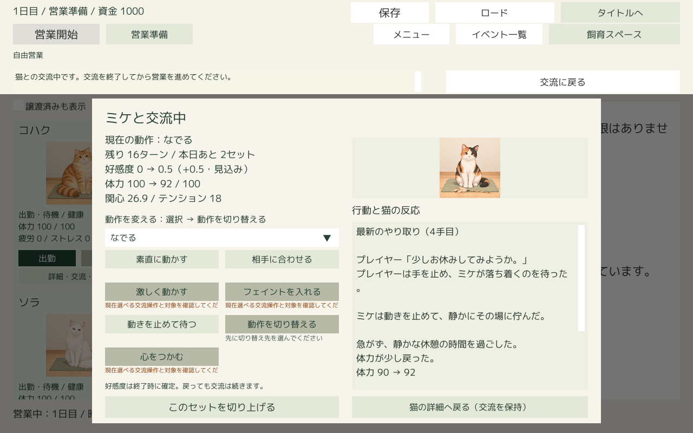
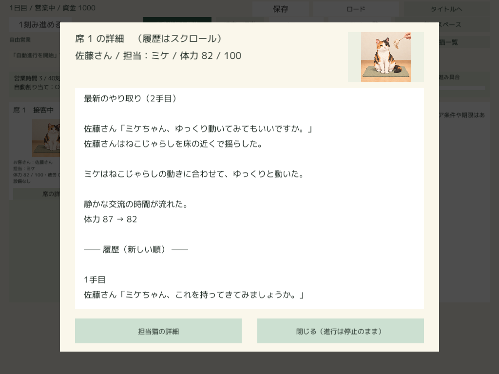

# 仮の交流文データのUnity取り込み確認

2026-10-16追補：以下は取り込み確認時点の記録。その後、[Editor Playの通常起動用にも有効化](ActiveInteractionCatalog.md)した。現在は同パックを通常参照先として維持している。

2026-10-15。ユーザーが制作した文章を修正せず、現在の登録済み素材を通常の書き出し処理から出力し、既存Unityプロジェクトへの取り込みを確認した。結果は成功。

## 書き出した内容

| 項目 | 数 |
| --- | --- |
| 猫の素材 | 7匹 |
| 同一画像をまとめたPNG | 194枚 |
| 登録済み人物のセリフ | 5条件・15案 |
| 登録済みミケの反応文 | 47条件・141案 |
| 交流文の合計 | 52条件・156案 |

パックIDは `75f31c320b3f4de7978ac2c77f7eada1`。保存先は作業ルートの `Logs/InteractionImportCheck/export/CatCafeContent-75f31c320b3f4de7978ac2c77f7eada1`。

下書きだけの文章は書き出されない。今回、人物のなでる（両人物の素直・相手に合わせる）、佐藤さんの休憩、ミケの休憩・低体力という実操作6条件が未制作として警告された。警告があっても取り込みは可能で、本文がない部品は既存の試作文で補う。ねこじゃらしの共通の拒否・戸惑いは未登録だが、操作専用文が登録されているので実操作では専用文を利用できる。

## Unityで確認したこと

- 通常の `ContentPreviewSetup.Import` を使用。パックID、内容ハッシュ、猫の対応、画像対応・画像ファイルのハッシュ検証が成功。
- 同じパックを2回取り込み、内容の一致を保って再取り込みできることを確認。
- UnityのResources経由で52条件・156案と画像を読み込み、実際の行動・確定反応に合った登録済みの猫の文章が選ばれることを確認。
- なでるの人物セリフが未登録でも、既存の試作文で補われて進行できることを確認。
- 通常の保存・ロード窓口で完成文章が同一であることと、再表示でゲーム状態が変わらないことを確認。
- 既存シーンのCanvasを描画。個別交流の最新・履歴、席の詳細1024×768・1280×800・1920×1080、空席を確認。文章・画像の表示が成功。

Unity 2021.3.45f1のEditor検証で終了コード0。プロジェクトの版指定は元の2021.3.45f2に戻した。入口は `CatalogVerification.VerifyAuthoredPack`、入力パックは `CATCAFE_IMPORT_PACK`、記録先は `CATCAFE_NARRATIVE_OUTPUT` で指定する。今回は取り込み確認のため、配布Playerの再ビルド・手動通しプレイは実施していない。

## 残した状態

元の文章・下書き・画像登録情報・紹介文のファイルハッシュが検証前後で同一であることを確認した。仮文章は校正していない。

検証後はUnityの `catalog.json` を元の参照先に戻し、この検証で新規作成した一時取り込みフォルダだけを取り除いた。既存の素材パックは保持。つまり、取り込み可能なことを確認した状態であり、通常起動時の素材参照先を今回のパックへ切り替えた状態ではない。

通常の制作環境へ反映する場合は、Unityの `Cat Cafe → 素材 → 素材パックを取り込む…` で上記の書き出しフォルダを選ぶ。下書きも反映したい場合は、制作ツールで確認登録してから新しく書き出す。

容量増加は、再利用できる書き出しパック383,645,479バイト（約384 MB）とログ・保存・画面記録約1.36 MB。画像194枚を含むためで、パックは1組だけ残した。ツールの生成フォルダは開始・終了とも6,058ファイル・2,820,683,986バイトで変化なし。共有Latestビルドも156ファイル・4,184,220,754バイトの1組のまま、Pendingなし。ビルドやUnityプロジェクトの複製は作成していない。

