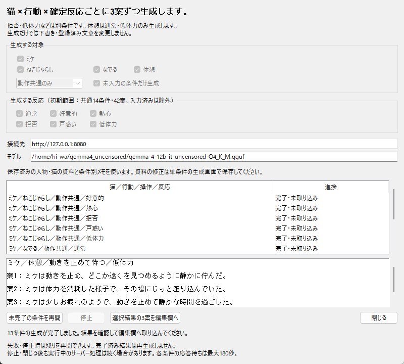

# 猫の反応文の連続生成

2026-10-15。人物のセリフに続き、ミケの反応文もアプリの画面から条件別に連続生成できるようにした。

## 操作

1. 「文章」→「日常交流の文章を編集…」を開く。
2. 「文章の種類」を「猫の反応」にする。連続生成ボタンが「猫の反応を連続生成…」へ変わる。
3. ボタンを押し、動作・操作の範囲・反応を選ぶ。
4. 「選択条件を連続生成」で順番に生成する。
5. 結果を一覧で選び、3案を確認して編集欄へ取り込む。必要なら修正し、下書き保存・内容確認・登録を行う。

初期状態は「動作共通のみ」「未入力の条件だけ生成」で、6種類の反応をすべて選択する。既存の下書き・登録済み本文・編集中の本文が1案でもある条件は除外する。猫の反応ごとに候補を作り、人物のセリフとは混ぜない。

| 範囲 | 条件数 | 生成案数 |
| --- | --- | --- |
| 動作共通のみ | 14 | 42 |
| 操作別のみ | 36 | 108 |
| 共通＋操作別 | 50 | 150 |

数は未入力条件の除外前。ねこじゃらし・なでるは通常／好意的／熱心／拒否／戸惑い／低体力を選べる。休憩は通常・低体力だけを対象にし、休憩の拒否など存在しない組み合わせは作らない。反応を絞って少数ずつ生成することもできる。

人物用と猫用の画面はそれぞれ保持され、開き直すボタンで同じ画面へ戻れる。一覧には猫・動作・操作・反応を表示し、取り込み先もその条件になる。停止・失敗後の未完了条件だけの再開、生成記録の保存、閉じる際の受け取り中止は人物用と同じ。閉じた画面のキュー復元は未対応。

## 資料と本文の扱い

保存済みのミケの資料は変更しない。現在のローカル設定では不足していた49条件の絵メモを補った。既存の猫の1条件と人物の資料・メモ、接続先・モデル・共通の文章の希望を保持している。

補ったメモは「動作・操作・確定反応」「反応を変えない」「未確認の姿勢・背景・小道具を追加しない」という制作上の制約であり、実画像の観察記録ではない。画像を確認して詳細を加える場合は、単条件の生成画面で編集・保存する。別環境で資料が未設定なら、従来どおり全条件の送信前に不足を案内する。

猫用プロンプトは、確定反応を性格・雰囲気より優先し、低体力を喜び・なつき・喉鳴らしで代用しないこと、休憩の睡眠・回復を断定しないことを補強した。意味や画像との一致は形式検証だけでは保証できないため、生成案を確認して修正する。生成だけでは下書き・採用済み素材へ保存しない。

## 検証

- 専用8テストが成功。共通14／操作別36／全50条件、休憩の反応制限、反応選択、不正・未選択の拒否、入力済みの除外、資料の条件対応、人物と猫の画面分離、猫の途中失敗・再開・正しい条件への取り込み・未保存を確認。
- 既存の交流文編集17、単条件LLM生成10、画像付きプレビュー14も成功（合計49テスト）。
- 実際のアプリ画面から既存のローカルLLMで、共通の未入力13条件・39案を連続生成。通常のねこじゃらし1条件は入力済みとして除外され、拒否・低体力を含む残りの条件が完了した。
- 低体力の生成案に好反応のような表現があったため指示を補強し、なでる・休憩の低体力2条件・6案を追加確認。生成案の品質確認と校正は引き続き必要。検証案は採用していない。
- 最小800×720で実画面を描画し、ボタン・選択欄が枠内に収まることを座標と目視で確認。既存の下書き・採用済み本文が検証前後で同一であることも確認した。

検証記録は `Logs/CatInteractionBatch`（約0.16 MB）。生成先を専用ログへ変更したため、制作中の生成フォルダは開始・終了とも6,009ファイル・2,820,416,048バイトのまま。Unityビルドやゲームセーブは変更していない。成功ビルドはLatestの1組・156ファイル・4,184,220,754バイトのままで、Pendingなし。

