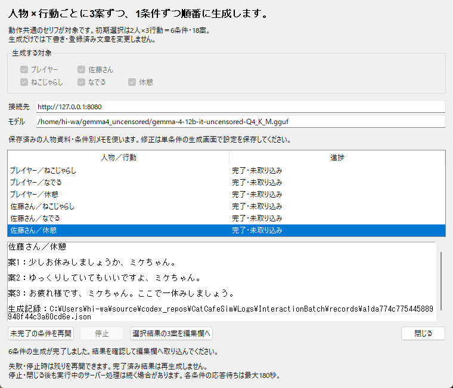
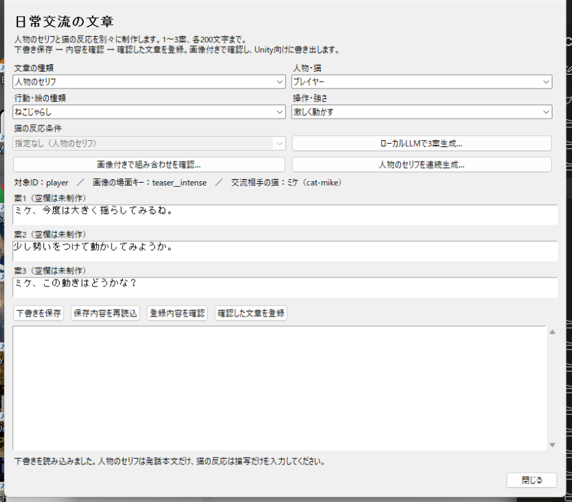

# 人物のセリフの連続生成

2026-10-15。人物・行動ごとに生成画面を開き直す負担を減らすため、選択した条件を1つずつ順番に生成する画面を追加した。対象はプレイヤーと佐藤さんのセリフ。同日追補で、共通文に加えて操作別の連続生成と未入力条件の抽出にも対応した。さらに[猫の反応文の連続生成](CatInteractionBatchGeneration.md)にも対応した。

## 操作

1. 「文章」→「日常交流の文章を編集…」→「人物のセリフを連続生成…」を開く。
2. 人物・行動と範囲（動作共通のみ／操作別のみ／共通＋操作別）を選ぶ。編集画面から開いた初期状態は「共通＋操作別」と「未入力の条件だけ生成」。全条件は2人×9条件＝18条件・54案、共通のみなら6条件・18案。
3. 保存済みの接続先・モデルを確認し、「選択条件を連続生成」を押す。必要ならこの画面だけの接続先・モデルも変更できる。
4. 一覧に「待機」「生成中」「完了」が表示される。1条件の生成が終わると次の条件へ進む。同時に複数のリクエストは送らない。
5. 完了後、一覧の結果を選んで3案を読み、「選択結果の3案を編集欄へ」を押す。
6. 編集画面で修正し、下書き保存・内容確認・登録する。他の結果は連続生成画面に残るので、再び同画面を開くボタンを押して戻り、次の条件を確認する。

人物資料・条件別の絵のメモ・文章の希望は、単条件の生成画面で保存した設定を利用する。開始前に全選択条件の資料を検証し、不足があれば送信前にその人物・行動を案内する。開始時に資料を複製し、途中で別画面の設定を変えても進行中の条件は変更しない。

対象を変えて別の連続生成を行うときは閉じて開き直す。開始後の人物・行動は固定される。接続先とモデルは、失敗・停止からの再開時に変更できる。この画面での変更は設定ファイルに自動保存しない。

## 停止・失敗と保存

- 「停止」は現在の応答待ちが終わるまで待機し、それ以上の条件を開始しない。二重実行を防ぐため、その間は再開を受け付けない。サーバー側の推論を強制終了する機能ではない。
- エラー時はその条件で止まり、次の条件へ勝手に進まない。「未完了の条件を再開」で失敗した条件から再試行する。完了済みの条件は再生成しない。
- 完了した3案は画面内に保持する。各条件の生成記録JSONも既存の生成先 `generated/interaction_texts` に保存する。画面を閉じると実行中の結果の受け取りを中止する。
- 画面を閉じた後のキューの復元・結果一覧の再読込は未対応。生成記録ファイルは残るが、新しく開いた画面は別の生成として開始する。
- 下書き・採用済み素材は自動更新しない。取り込みは選んだ1条件の3案を編集欄へ入れるだけ。既存の未保存編集があれば、従来の保存・破棄・キャンセル確認に従い、キャンセル時は結果も保持する。

## 確認結果

| 確認 | 結果 |
| --- | --- |
| 専用5テスト | 6条件の準備・資料不足・設定の複製、途中失敗と完了済みを除いた再開、停止待ち中の二重実行防止、閉じる際のキャンセル、未保存文の保護・未登録の取り込みが成功 |
| 既存49テスト | 単条件LLM生成10、交流文編集17、画像制作8、交流プレビュー14が成功。単条件の個別選択取り込みと確認登録を維持 |
| 実ローカルLLM | 既存の接続設定と人物資料で6条件・18案を順次生成し、全条件の形式検証と生成記録保存が成功。下書き・採用済み本文は変更なし |
| 実画面 | 最小760×650で一覧・結果・操作ボタンを確認し、ボタン・選択欄が枠内に収まることも座標で確認 |

実モデルの生成案には「これを持ってきてみましょうか」など、意図と合うか手直しが必要な表現もあった。人物像・動作・絵との一致や3案の変化は、取り込み前後に人が確認する。成功は生成と形式確認の完了を意味し、自動採用や全文章の品質保証を意味しない。

検証記録・実モデル出力は `Logs/InteractionBatch`、代表画面は本資料に添付。今回の実モデル検証は生成先を専用ログへ変更し、制作中の生成フォルダ・素材・セーブは変更しなかった。Unityビルドは行っていない。

開始・終了時とも生成フォルダは6,009ファイル・2,820,416,048バイト。追加した専用ログは約0.10 MB。共有ビルドはLatestの1組・156ファイル・4,184,220,754バイトのまま、Pendingなし。

## 操作別の不足補完（同日追補）

ねこじゃらしは共通・素直・相手に合わせる・激しく・フェイント、なでるは共通・素直・相手に合わせる、休憩は1条件。「操作別のみ」では共通文と休憩を除いた12条件を対象とする。一覧にも操作名を表示し、縦スクロールで全条件を確認できる。

「未入力の条件だけ生成」は、下書き・登録済み素材・現在の編集欄のいずれかに1案でも本文がある条件を除く。部分的に入力した条件も上書き対象にはしない。この設定を外せば入力済み条件も再生成できるが、保存や登録は引き続き自動で行わない。開始前に対象を抽出するため、実行後に別画面で変えた内容を自動更新する機能ではない。

専用テストを6件に拡張し、全18条件、操作別12条件、入力済み条件の除外、編集中の未保存文の除外を確認した。既存の交流文編集17件も成功。実際のアプリ画面からローカルLLMへ不足12条件を順次送信し、36案の完了を確認した。

今回は生成後の本文を校正し、既存のアプリの取り込み・編集・下書き保存処理を通して不足12条件に保存した。これで両人物の対象18条件・54案が下書きに入っている。既存の下書き6条件はそのまま保持し、登録済み素材も変更していない。完了したのは下書きの補完であり、全54案を採用・Unity反映した状態ではない。

追加した36案は [校正済みの下書き記録](Results/InteractionSpeechCompletion/reviewed.json) にも記録した。未確認の見た目（キラキラなど）、背景物、猫の動作の強制、猫の好きな場所の断定、幼児語、過剰な敬語などを直した。既存文への校正は今回の不足補完に混ぜていない。

記録は `Logs/InteractionSpeechCompletion`（約0.53 MB）。生成フォルダは開始・終了とも6,009ファイル・2,820,416,048バイトで変化なし。素材パックとゲームセーブ、Unityの共有Latestビルドも変更していない。

編集画面で全18条件・54案を再読込し、未入力条件が残っていないことも確認した。開いたままの編集画面では「保存内容を再読込」を押すと補完分を表示できる。

