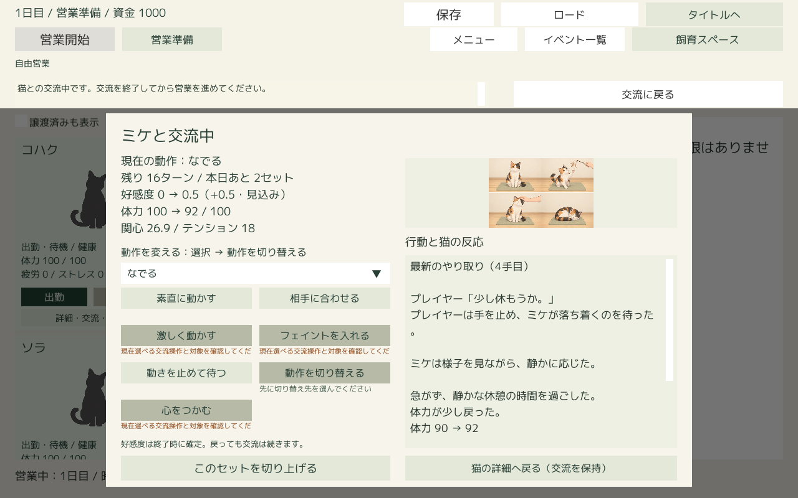
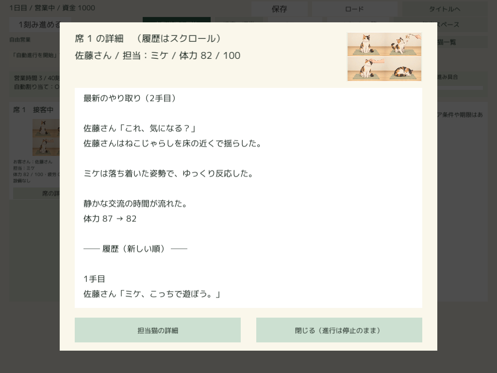

# 採用済み交流文のUnity接続

2026-10-16追補：[Editor Play用の有効化と3案の切り替え確認](ActiveInteractionCatalog.md)を実施。通常参照先を登録済み交流文を含むパックへ更新し、案1→2→3→1と保存再開後の継続を確認した。

2026-10-15追補：[ユーザーが制作した仮文章の取り込み確認](AuthoredInteractionImportCheck.md)も実施した。登録済み52条件・156案を通常の書き出し・取り込みから読み込み、両画面の表示と保存・ロードを確認。

2026-10-15。制作ツールが書き出す `interaction_texts.json` を素材パックと一緒に取り込み、ミケの「席の詳細」と個別交流の文章表示に接続した。ゲーム中にLLMを呼び出さず、制作時に確認登録された本文だけを使う。

## 利用方法

1. 制作ツールで人物のセリフ／ミケの反応を条件別に確認登録し、画像付きプレビューを確認する。
2. 既存の素材書き出しを行う。`bundle.json` と同じフォルダに交流文カタログが出力される。
3. Unityの `Cat Cafe → 素材 → 素材パックを取り込む…` でそのフォルダを選ぶ。
4. 通常のゲーム画面でミケとの交流、またはミケを勤務させた接客を進める。

人物の対象は `player` と佐藤さんの `guest-1`、猫は `cat-mike`。ゲーム猫IDと制作側画像IDの明示的な対応を利用する。未登録客に佐藤さんのセリフを流用しない。対象の人物・行動・操作・反応の文章がなければ、その部品は既存の試作文で補う。

## 選択と保存

- ねこじゃらしは素直・合わせる・激しく・フェイント、なでるは素直・合わせる、休憩に対応する。
- 確定した実行動と反応を受け取り、操作専用の条件を優先し、なければ同じ動作・同じ反応の操作共通 `any` を探す。異なる反応の文では補わない。
- 人物のセリフと猫の描写は独立に選ぶ。候補は登録順に巡回し、複数あれば直前の同じ本文も避ける。1候補なら再使用する。ゲーム結果の乱数を消費しない。
- 行動文は操作別、地の文は実反応別の共通文を使う。実際の体力回復・枯渇・心を開いた結果はゲームの確定値から加える。
- 完成文章、各部品、候補ID・条件キー、カタログの内容ハッシュ、選択画像のResources参照を保存履歴へ記録する。本文の再表示・ロード時には再選択しない。カタログ更新後も過去の本文と参照は保持する。
- 席は日・客ID・猫ID・着席刻、個別交流はセットIDで分離する。閲覧・再表示は行動を実行しない。

画像は書き出し時の対応表を使い、操作専用→動作→ねこじゃらしのplay／その他のnormal→normalの順で解決する。休憩にsleepは流用しない。既存の特別な心を開くイベント画像の優先処理は維持する。古い画像を再表示するには元の取り込み済みパックが必要で、取り込み処理は以前のパックを削除しない。画像がなくなった場合は既存画像選択へ戻るが、本文は変更しない。

## 取り込みと互換性

形式・候補ID・重複・条件・本文長・画像パス・内容ハッシュを確認し、素材パックID、猫画像ID、画像対応と実ファイルのハッシュも照合する。検証完了後に専用の一時フォルダから配置し、最後に参照先を切り替える。同じパックIDの内容変更は拒否し、制作ツールからの新規書き出しを必要とする。

交流文のない旧パックは従来どおり利用できる。文章のない旧セーブ／従来の完成本文だけを持つ保存も読める。実行時にカタログを読めない場合は警告を記録して試作文で続行する。既存のゲーム状態、数値ルール、リプレイ用ダイジェストは変更しない。

## 検証

専用の短い確認文を作るfixtureを使用し、制作中の採用文や通常のセーブは変更しない。画像は既存の4場面の見本画像1枚を複数キーへ対応付けた検証素材であり、反応別イラストの完成・意味上の校正まで保証するものではない。

| 検証 | 結果 |
| --- | --- |
| .NET専用96チェック | PythonとC#の内容ハッシュ一致、全対象操作の行動文、確定反応の候補選択、操作専用／共通、3候補の巡回、1候補、不足部品の補完、保存・再開、更新後の旧本文保持、30回の閲覧、20手のゲーム状態・乱数不変、客交代、旧保存、不正カタログ拒否が成功 |
| 既存の文章履歴67チェック | 成功 |
| Unity | JsonUtilityでの内容ハッシュ、Resources読み込み、本文・画像選択、不正取り込み時の参照保持、再取り込み、同一ID変更拒否、通常保存窓口での保存・ロードを確認 |
| 実画面 | 個別交流の最新・履歴、席1024×768・1280×800・1920×1080、空席をCanvas描画。席に選択画像を追加し、個別交流は17ポイント・行間1.05へ調整 |
| Windows Playerの別プロセス | 保存済みの完成本文と画像参照を読み込み、画像が存在すること、本文の一致、20回の閲覧によるゲーム状態不変を確認。終了コード0 |

短い最新文が個別交流の表示枠に収まることもUnityで数値確認した。200文字までの制作文や履歴はスクロールで読む。





拒否は標準ミケの好みでは到達しないため、既存と同じく好みを0にした検証プロフィールで実判定の `turn_away` を確認した。標準のミケや数値ルールは変更していない。好反応・低体力も実判定に従う。

記録は `Logs/InteractionCatalog`、ビルドは共有の `Logs/StandaloneBuild/Latest`。検証入口は `CatalogVerification.VerifyAndBuild`。検証中だけQAパックを有効にし、ビルドの通常参照先と検証後のプロジェクト参照先は元に戻す。別プロセスの再開確認に使う画像のため、検証ビルドには非選択のQA素材も含める。プロジェクト内に一時取り込みしたQAパックは検証終了時に取り除く。

容量は開始時3,244,326,124バイト→終了時4,184,220,754バイト（約4.18 GB、+939,894,630バイト）。ビルドログの前回との差分では、作業前からUnityに存在した現行パック `f11cad7b3f174d86a8ca4b102e9dc480` の約895.6 MiBの素材が今回初めてビルドへ含まれている。Resources内の既存パックも同梱されるため増加した。今回のQA素材は約0.77 MiB。既存素材は削除せず保持した。成功ビルドはLatestの1組・156ファイルだけで、Pendingなし。ツールのgeneratedは2,820,370,503バイトから変化なし、専用のログ・fixture・保存・画像記録は約5.06 MB。

## 再現手順

作業ルートから以下を実行する。Unityを閉じておき、インストール済みEditorを指定する。検証時は2021.3.45f1を使用し、プロジェクトのEditor版指定は元の2021.3.45f2へ戻した。

```powershell
python cat_cafe_sim_tool/tests/make_narrative_fixture.py Logs/InteractionCatalog
dotnet build cat_cafe_sim_tool/tests/standalone/StandaloneChecks.csproj -p:UseAppHost=false
$pack = Get-Content Logs/InteractionCatalog/fixture-path.txt
dotnet cat_cafe_sim_tool/tests/standalone/bin/Debug/net8.0/StandaloneChecks.dll --catalog cat_cafe_sim_tool/unity_preview_template/Resources/CatCafeStandalone/rules.json $pack Logs/InteractionCatalog/dotnet
$env:CATCAFE_CATALOG_FIXTURE = $pack
$env:CATCAFE_NARRATIVE_OUTPUT = "$PWD/Logs/InteractionCatalog/unity"
cat_cafe_sim_tool/build_standalone.ps1 -ProjectPath C:/Users/hi-wa/unity_workspase/CatCafeSim -UnityPath 'C:/Program Files/Unity/Hub/Editor/2021.3.45f1/Editor/Unity.exe' -ExecuteMethod CatCafePreview.Editor.CatalogVerification.VerifyAndBuild
```

生成済みPlayerへ `-batchmode -nographics --catcafe-narrative-resume <CATCAFE_NARRATIVE_OUTPUTの絶対パス>` を渡すと、同じ保存から別プロセス再開を検証できる。

実画面検証はCanvas描画と目視であり、長時間の手動操作テストではない。人物の自由登録、他の猫、全交流種別、終了済みセットを選ぶ回想、反応別画像の本制作と本文の校正は後続。
