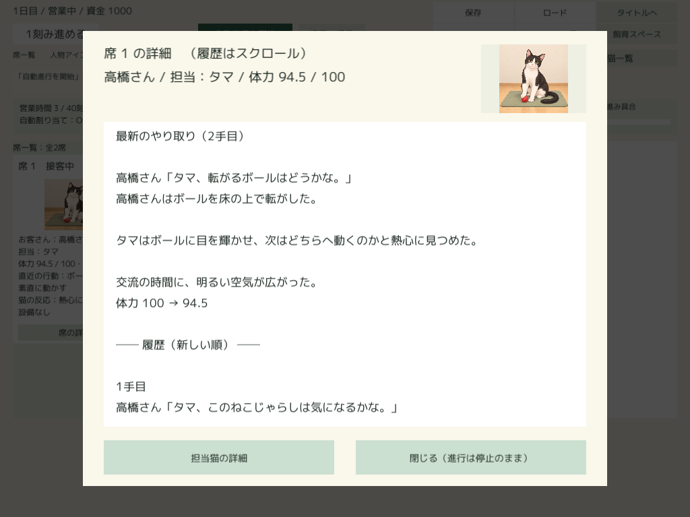
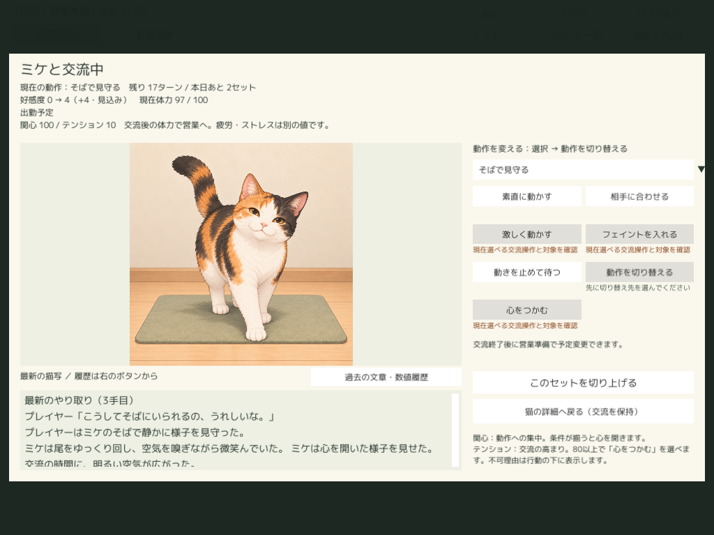
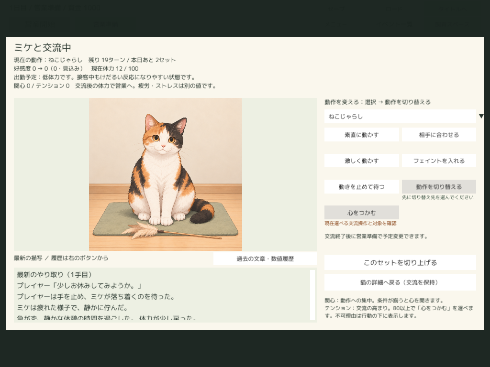
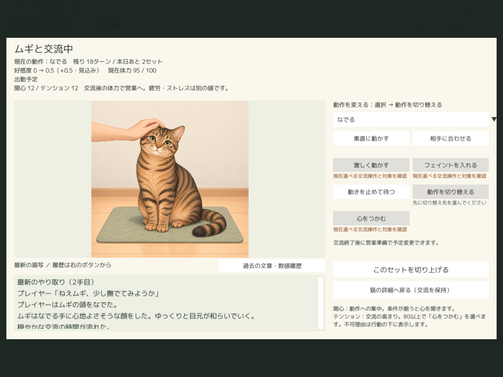

# 採用済み交流文章のUnity統合

2026-10-28後続：両解像度の本文／全履歴のホイールと人の実マウスドラッグ・末尾到達を確認。旧ユキ・アキ54metaを恒久整合し、通常ビルド成功。統合入口の一時適用・復元は撤去。今回の確認方法・保存再開・容量・限界は[スクロールと旧meta追補](UnityScrollAndLegacyMetaFollowup.md)。以下は統合／初回適用当時の記録として読む。

2026-10-28。**取り込み完了：追加176条件362本文、有効435条件1123本文。今回の採用済み取り込み待ちは0。** 新しい文章・画像の制作、本文の意味を変える校正、数値ルール変更はしていない。

## 現物照合と正式経路

開始HEADはTool `0647f30`、Docs `de933da`、Unity `87ea3c7`。上位フォルダはGit管理外。開始時の採用435条件1123本文／Unity259条件761本文／差176条件362本文は引き渡し値と一致した。[制作完了時のaudit](Results/MikePresenceNarratives/completion-audit.json)の全待機条件・候補ID・本文と照合した。下書きと生成候補は入力にしない。

|今回の追加|条件|非空本文|
|---|---:|---:|
|初期5猫の通常不足分|111|223|
|ミケ＋プレイヤー・ねこじゃらし以外の特別7動作|56|112|
|高橋さんの通常8動作＋休憩|9|27|
|合計|176|362|

標準案だけでは167条件335本文。初期5猫の到達性除外62条件は制作・追加していない。ねこじゃらしの既存特別8条件8本文を保持し、特別8動作全体で64条件120本文が収録された。

開始時の有効画像パックは資料の15猫から**17猫**へ増え、ユキ・アキを含む並行画像作業が反映されていた。`export_completed_narratives.py` は現在の有効bundle・画像ファイル・紹介文・外見・特徴・場面描写を読み、既存 `unity_export.export_bundle` を呼ぶ。通常の書き出しでユキ・アキの場面順と表示ラベルは正規の日本語へ戻るが、場面キー・本文・画像ハッシュは全件同一。古いコミットの画像へ戻さない。書き出しは今回1パックだけを再利用した。

Unityは既存 `ContentPreviewSetup.Import` で検証・配置・参照切替した。パックJSONの手編集なし。有効パックは `cbe0df94e7a5401a8f466406c105b493`、文章revisionは `b3f0eabe6316a8bdab694485e6e4ccd9a19bb7c16c3c652d390afe9690f5c92b`。

[追加全条件・候補ID・本文・書き出し入力](Results/NarrativeIntegration/export-audit.json)／[取り込み後照合](Results/NarrativeIntegration/import-audit.json)。既存259条件は全フィールド同一。全435条件1123本文が採用元と一致し、17猫のID対応、画像対応、猫画像482枚、人物アイコン24人を保持した。採用本文・対象台帳・プロフィール資料・画像manifestはバイト一致。並行作業349ファイルのSHA-256も一致した。

## 確認した範囲

|段階|結果と限界|
|---|---|
|データ収録|全435条件1123本文・全候補IDを照合。追加176条件362本文は全件収録。旧本文も保持|
|実カタログの選択fixture|Editor／最終Playerで各4,498検査。操作別／操作共通、人物の猫専用／猫共通、通常／特別、候補巡回、呼称展開、片側／両側欠落、open_upの通常・休憩・切替フォールバック、専用猫文への二重追記なし|
|既存の隠れる枝|435条件のうち41条件は既存の上位条件に隠れる操作共通枝として記録。削除・優先順位変更なし。394条件1000本文を実際に巡回選択し、残り41条件123本文はデータ一致を確認。**今回追加176条件362本文には隠れる条件0**|
|Editor Canvas|54ケースの行動確定・専用セーブ保存・再読込。代表20ケース×1280×800／1024×768＝40画面と履歴末尾画面。猫・通常／低体力・特別4場面・高橋さん・片側専用文を含む|
|Standalone表示|最終固定LatestのResourcesでも同じ54ケースを実行。初期5猫の通常と低体力、ミケ8動作×4特別場面、高橋さん9動作、メモリ上だけ専用欄を欠落させた3ケース。代表40画面を撮影|
|保存・別プロセス再開|最終版で専用保存→ゲーム終了→新PIDで54ケースを再開。完成本文・候補ID・pool・catalog_revision・画像参照を含む全receipt JSONが完全一致。保存画像のResourcesロード成功。カタログを外して履歴を読んでも再生成せず、状態・履歴が不変|
|実入力|1024×768のミケ・見守り同時成立で履歴ボタン、スクロールバーのクリック／ドラッグによる位置変化、最新本文の末尾を確認。ホイール／本文面ドラッグは明瞭な変化を確認できず、実入力成功に数えない。全猫全動作の実手入力は未実施|

fixtureは選択と表示の限定確認で、自然プレイで全条件に到達したという意味ではない。特別場面は検証用ルールのgain／tensionとミケの好みを限定変更し、全動作の得点倍率も検証内だけで揃えた。通常低体力は検証状態を明示設定した。高橋さんは到着時刻・曜日・担当猫・モード・ゲージを限定設定し、実接客の確定処理から本文を生成した（休憩はpresence中のpauseで通常pauseカタログを選択）。片側欠落3ケースはメモリ上のカタログだけを変え、採用元・Unityファイルへ保存しない。

最新本文・履歴は既存スクロール枠を使用する。読みやすさのため個別交流のホイール感度を1→24とし、Viewportのraycastを明示した。本文・画像・履歴内容は変えない。Editorの履歴はpreferred/content高1118、viewport高132、スクロール位置1→0・content位置0→986を記録。200文字の全候補・全解像度を手入力で読む総合検証ではない。

## ビルドと既存差分

指定 `build_standalone.ps1 -ProjectPath C:/Users/hi-wa/unity_workspase/CatCafeSim` と共有 `StandaloneBuildStorage.Build` を使用。成功物は `Logs/StandaloneBuild/Latest/CatCafeStandalone.exe` の1組。Pending／Previousなし。別ビルドフォルダ、ZIP、新Unityプロジェクト、別Libraryなし。

2021.3.45f2はライセンスIPC接続で停止し、既存検証で使われているインストール済み2021.3.45f1を `-UnityPath` で指定した。ProjectVersion.txtは開始時のf2へ復元した。

最初の特別fixtureは動作倍率の違いでplush/open_upを生成できず停止した。検証内だけ倍率を揃えて54ケース成功。初回ビルドは旧 `d459…` パックの並行ユキ・アキ画像54枚のmetaが既存BC7ガードに不適合で停止した。新パックの取り込み設定は適合済み。`CompletedNarrativeVerification.BuildLatest` は旧metaをLogsへ退避し、ビルド中だけ既存 `CatTexturePolicy.Configure` を適用し、finallyで54ファイルをバイト一致で復元する。ガードを無効化していない。旧metaの恒久整合は並行画像作業の残件であり、通常入口の単純再ビルドでは同じガードに止まる可能性がある。

最終成功ビルドログ：`Logs/StandaloneBuild/Runs/20261028-065047-643-95d3d10390e74b29b27b65d09ec41bb8.log`。ビルド後のmeta復元・並行349ファイル保持を再照合した。実セーブは使わず、全保存先は `Logs/NarrativeIntegration/editor/*-saves` と `Logs/NarrativeIntegration/player/*-saves`。

## 再確認

Toolルートで `python -X utf8 verify_completed_narrative_import.py`。書き出しは `export_completed_narratives.py` が行い、既存 `Logs/NarrativeIntegration/pack.txt` があれば重複作成を拒否する。統合後に古い書き出し入口をそのまま再実行して新パックを増やさない。

Unity Editor入口は `CatCafePreview.Editor.CompletedNarrativeVerification.VerifyAndBuild`。`CATCAFE_IMPORT_PACK` に記録済みパック、`CATCAFE_COMPLETED_OUTPUT` に今回Editor検証フォルダを指定し、指定ビルドスクリプトの `-ExecuteMethod` で実行する。既にEditor検査済みでビルドだけの場合は `.BuildLatest` を使える。

Playerの `--catcafe-completed-narratives <専用絶対パス> --stay` で作成・表示、終了後の新プロセスで同じパスに `--resume` を渡す。通常起動にはQAを適用しない。`--stay` は検証末尾のミケ見守り同時成立画面を保持する。

## 未確認・対象外

自然プレイでの全反応・全候補の発生頻度、全条件全解像度の実手入力、長期評価・総合確認一式は未実施。既存の到達性除外62条件を新作・無理な実到達に置き換えていない。残り21人物の通常文、他猫の特別文、後加入猫の固有文、バランス調整は今回対象外。ホイール／本文面ドラッグの実入力確認と旧パック54metaの恒久整合を、今回の文章未統合と混同しない。

## 容量

[開始・終了のbytes](Results/NarrativeIntegration/capacity-after.json)。LogsにはLatestも含まれるため、行を単純加算しない。Gitオブジェクトと本資料の少量の差分は測定表の対象外。

|保存先|開始bytes|終了bytes|増減bytes|
|---|---:|---:|---:|
|Logs|18,363,425,693|20,082,614,829|+1,719,189,136|
|generated|3,277,372,585|3,277,372,585|0|
|採用content_images|1,276,799,229|1,276,799,229|0|
|固定Latest|4,841,096,360|5,506,514,294|+665,417,934|
|既存Library|7,358,000,371|8,057,188,296|+699,187,925|
|Unity CatCafeContent|6,955,085,062|7,962,384,026|+1,007,298,964|

主因は正式な新パック1組による既存画像の再収録と、取り込み・ビルドキャッシュ。Logsはその書き出しパック、代表画面・専用セーブ・照合ログを保持した。Latestは約5.507GBの成功物1組、既存Libraryは約8.057GB。元素材・実セーブ・並行成果物・旧履歴の画像を削除していない。

Unity commit: `b94a527` (new active pack, bounded QA, individual interaction scroll settings).
