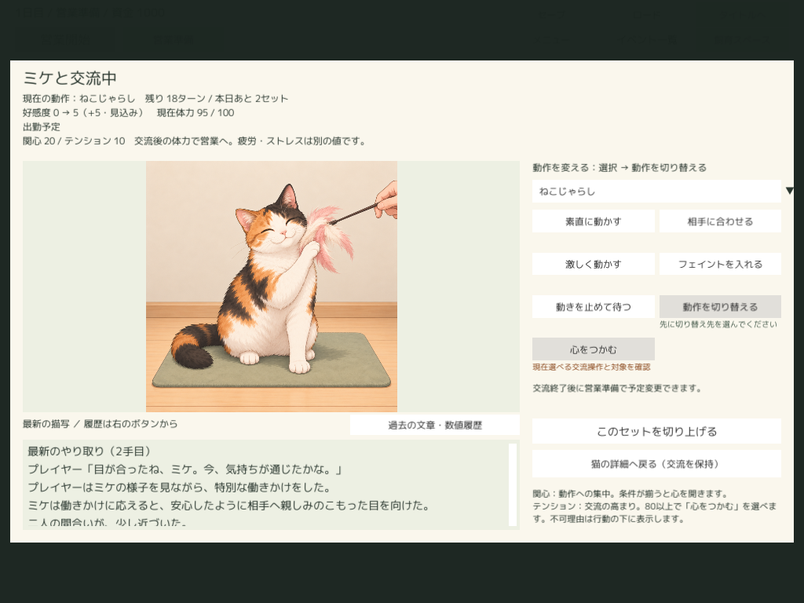
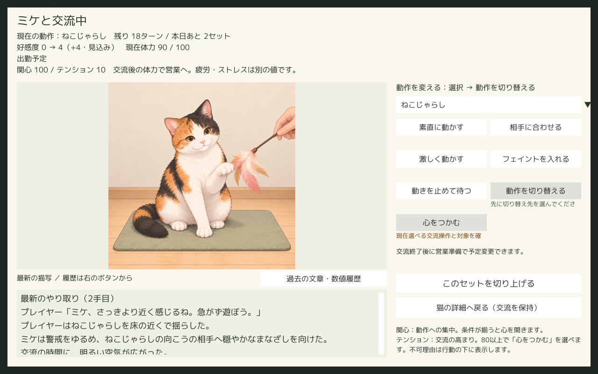
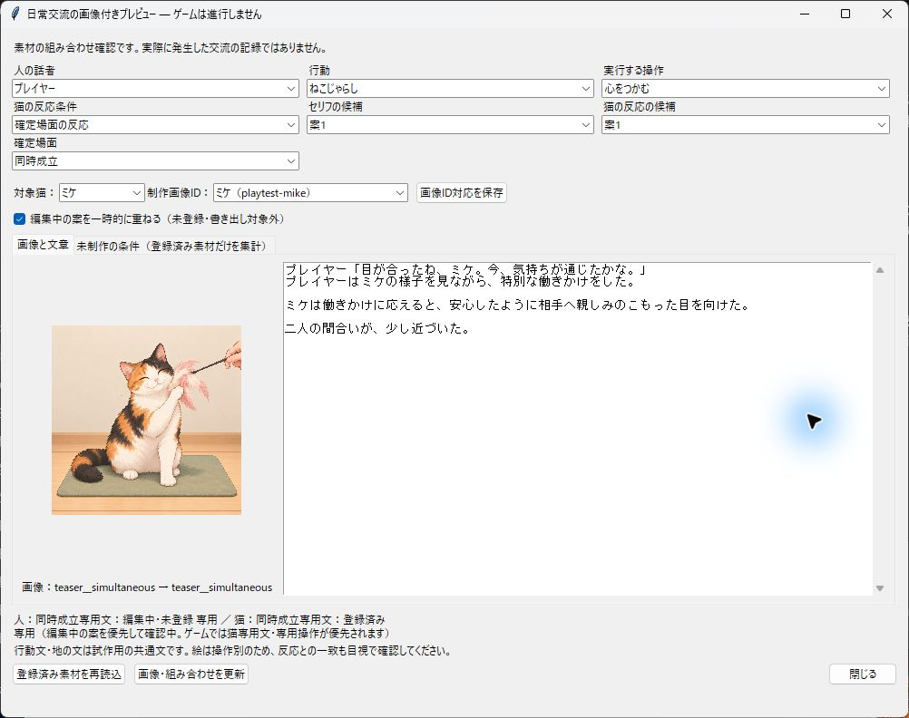

# 特別場面の文章制作・Unity選択・保存

2026-10-27追補：ミケ＋プレイヤー・ボール遊びの4場面8欄に各2案、計16本文をTool確認登録。Unity未取り込み。[制作本文・候補ID・校正・限定確認](MikeBallSpecialNarratives.md)。以下のねこじゃらし代表例・配布版確認の範囲とは別。

2026-10-27。対象は `switch / connect / open_up / simultaneous` の制作枠と、プレイヤー＋ミケ・ねこじゃらしの代表8欄。全人物・全猫の本文充足は対象外。[採用計画](../../Docs/SpecialInteractionNarrativePlan.md)／[通常文](AllNormalInteractionNarratives.md)。

## Toolでの操作

1. 画像制作画面から「日常交流の文章」を開き、「確定場面」を選択する。人物／猫、切替先または現在の動作、必要な操作を選ぶ。特別場面では休憩を動作として選ばず、心を開く＋休憩は現在の8動作と操作「動きを止めて待つ」で指定する。
2. 人物文は猫共通（`target_cat=*`）または猫専用を選択。各欄は独立し、1～3案・各200文字。手入力→下書き保存→登録内容を確認→確認した文章を登録。現在の1条件だけを登録し、空欄は候補にならない。
3. 単条件生成は選択中の場面を渡す。連続生成は別の「確定場面」選択を明示する。共通／操作別の範囲を選び、未入力のみ・空欄補完・スキップ・下書き・対象限定のまとめ確認登録を既存手順で行う。switch/connect/simultaneousは1操作のみなので「操作別のみ」を選択肢から外す。特別場面では休憩の動作チェックと通常反応チェックを無効にする。
4. 「前回の続き」は保存済みジョブだけを復元する。旧計画へ特別場面を自動追加しない。新しい場面は新規画面で新計画を作る。
5. 画像付きプレビューの「確定場面」「実行する操作」「猫の反応条件」を選ぶ。専用文・編集中・通常文＋追記・既存定型文の採用元を人／猫別に表示する。open_upの反応条件は専用文の条件ではなく、通常文へ戻る際の確定反応を確認するための指定。既存画像を使用し、ゲーム状態・ターン・費用・体力は消費しない。
6. 不足タブは通常文と任意の特別文を分離する。特別文の未制作を通常文の欠落数へ加算しない。書き出しのvalidationにも `optional_special_scenes` を別枠で記録する。
7. 登録後は通常の「Unity向けに書き出す…」→Unity「Cat Cafe → 素材 → 素材パックを取り込む…」。代表例の限定出力は `export_special_narratives.py` が通常 `export_bundle` を利用し、既存パック範囲と高橋さんの取り込み待ち本文の除外を明示する。

生成には条件全体・確定場面・採用プロフィールを渡す。単条件と連続生成は同じクライアントを使う。人物の語彙・口調・着眼点を維持する指示を加えた。新しいLLM基盤・プロフィール生成機能は追加していない。実モデルの文章品質は確認登録時の人による校正が必要。

## 条件と版

| 項目 | 最終仕様 |
| --- | --- |
| 場面 | 省略可能な文字列 `narrative_scene`。省略は `normal`。特別値は上記4種類 |
| 既存条件 | kind / subject_id / mode / action / reaction / scene_keyと任意target_catを保持 |
| 動作 | 特別場面は8動作。switchは切替先。切替前動作は条件に加えない |
| 操作 | switchはswitchのみ。connect／simultaneousはconnectのみ。open_upは通常操作＋any（操作共通）＋pause／switch。実ルールで成立する組合せのみ |
| 反応 | 特別場面は両欄とも `reaction=any`。通常の反応分類と別軸で確定結果を扱う |
| scene_key | 既存の動作／操作キー規則を保持。本文の条件キーと実際の特別画像の選択を混同しない。特別画像はmode__open_up等を既存処理で選ぶ |
| 条件キー | 通常は従来と同一。特別条件だけ従来キーの末尾へ `/scene=場面名` を追加。人物のtarget_catはこの前に保持 |
| 候補ID | 従来のUUIDv5生成規則を継続。通常文のキー・候補ID・本文を移行時に作り直さない |
| Tool保存 | 旧version 1／2読込。特別条件が含まれるファイルだけversion 3。旧版ファイルへ特別条件を紛れ込ませた場合は拒否 |
| Unity文章カタログ | 特別条件ありはversion 4、全entryへnormalを含むnarrative_sceneを明示しrevisionへ含める。通常のみの出力は従来のversion 3を維持 |
| 保存済み行動 | CafeNarrativeRowのversion 1を維持し、任意narrative_sceneを追加。完成本文・候補ID・pool・catalog_revision・画像参照を行動確定時に保存 |

新Toolは旧Tool保存1／2と新保存3を読み、新Playerは旧文章カタログ1／2／3と新4を読む。旧Toolは新保存3を版で拒否し、旧Playerの取り込みは新カタログ4を版で拒否する。旧版へ新形式を持ち込む運用は非対応。新セーブを旧Playerで続行する下位互換は保証しない。

新Playerで旧セーブを開いても、過去の本文を最新パックで再生成しない。旧セーブの新しい行動から新選択を利用する。パック更新・閲覧・候補切替は行動を追加せず、完成履歴を変更しない。履歴の旧画像を保持するため、作業開始前の取り込みパックは削除していない。

## 確定結果からの選択

優先は同時成立→心を開く→心をつかむ→切替→通常。open_upは実際にopen_up_countが増えた結果、simultaneousはその結果とconnectの同時成立から決める。本文の有無は成功判定・数値・乱数を変更しない。

人物と猫を別々に解決する。人物の猫専用→猫共通、その中で操作専用→操作共通の既存順序を維持する。猫は自身の操作専用→操作共通。同じpoolの候補巡回・直前重複回避も維持する。

| 場面 | 専用文がない欄 |
| --- | --- |
| switch | 現在の切替定型文 |
| connect | 現在の心をつかむ定型文 |
| open_up | 現在の通常文。猫欄には従来の心を開く追記。pauseは休憩文、switchは従来の切替定型文＋追記 |
| simultaneous | 現在の同時成立表示。connect文とopen_up文を連結しない |

専用猫文を採用した欄には心を開く定型説明を二重追記しない。人物だけ／猫だけでも片方の専用文を利用できる。行動説明・地の文は従来の確定行動と結果を保持する。準備／実行／特別反応画像の選択は既存経路を維持した。

## 代表本文

既存Tk編集画面の下書き→内容確認→登録→再読込を通した手動制作。実LLMへの生成要求はしていない。人物はplayer・ミケ専用、猫はcat-mike、mode=teaser。open_upは操作共通any、それ以外は場面と対応する操作。各欄1案だけを登録した。

| 場面 | プレイヤー | ミケ |
| --- | --- | --- |
| switch | 今度はねこじゃらし。穂先の動き、気になるかな。 | {cat}は新しく出てきたねこじゃらしへ、そっと視線を移した。 |
| connect | {cat_call}、今だね。この間合い、つかめた気がする。 | {cat}は相手へ注意を向け、その働きかけをまっすぐ受け止めた。 |
| open_up | {cat_call}、さっきより近く感じるね。急がず遊ぼう。 | {cat}は警戒をゆるめ、ねこじゃらしの向こうの相手へ穏やかなまなざしを向けた。 |
| simultaneous | 目が合ったね、{cat_call}。今、気持ちが通じたかな。 | {cat}は働きかけに応えると、安心したように相手へ親しみのこもった目を向けた。 |

登録記録・条件・候補IDは [registration.json](Results/SpecialNarratives/registration.json)。実画面・容量・最終検証は同じResults配下と後段の記録を参照。

## 検証と範囲

- Python：通常交流文68テスト（Tk GUI含む）、特別場面4テスト成功。全8動作の条件、禁止操作、旧キー・候補ID、保存／再読込、入力検証、採用プロフィールと場面の生成送信payload、連続計画の固定・保存復元、各場面の専用／フォールバックの実Tk描画を検査。モデル通信はmockで、実モデル出力の品質評価ではない。
- C#：専用文111項目、別プロセス再開13項目、通常全動作609項目成功。専用文両方／人物のみ／猫のみ／なし、同時成立、二重追記防止、通常文への回帰、open_up＋pause／switch、本文有無でゲーム状態が変わらないこと、旧行動行と新行動、候補ID・版・画像参照・読取不変を確認。
- 旧カタログ：version 1（21条件）、version 2（180条件）、version 3の通常回帰を確認。新パックは既存251条件の全フィールドを保持し、代表8条件だけを追加した259条件。高橋さん27本文は除外し、元の登録データは保持。
- 最終Unity：通常Import／Resourcesと指定スクリプト・固定Latestを使用。4場面を実StepExchangeから確定させたfixtureで配布Playerに表示。switchはボールからねこじゃらしへの切替。両解像度の実描画、完成本文の保存、別プロセス再開、画像のResources読込、カタログを外した履歴の不変を限定確認する。

長期評価・全目標の通し確認は再実施していない。全人物・全猫の固有本文、実LLMサーバの品質、全客による自然発生、すべての候補組合せの実入力は未確認。画像・ゲーム数値・人物プロフィールの新規制作は対象外。

## 配布・実入力・容量の記録

最終検証記録と容量の数値は [verification.json](Results/SpecialNarratives/verification.json) を正本とする。fixture規則と製品規則を区別し、実入力は描画寸法と操作を別記録にする。

ビルド中だけPending、成功時に移動でLatestを置換する共有StandaloneBuildStorageを利用。開始時Latest 4,289,680,386 bytes。作業開始前のパック・素材・セーブは保持。初回はライセンスIPC接続失敗でビルド前終了、通常実行環境へ切替。共有パックの未コミット画像を拾った確認版の範囲を訂正し、open_up＋pause／switchの回帰修正を配布版へ反映した。各段階の機能ごとのビルドはしていない。

最終配布パック `d4594a5f9a7f483ca16ddfca4ea48486` はversion 4・259条件761候補・15猫／既存3話者。画像・人物アイコンは既存採用範囲を引き継ぐ。固定Latestの最終ビルドログは `Logs/StandaloneBuild/Runs/20261027-093910-795-9bd085bfe3ff401bb270ce243211e50e.log`。

実入力はfixture再開後の1024×768描画（ウィンドウ外枠を含む画像1026×800）。過去履歴を開く→スクロールバーで保存数値・前の履歴を表示→最新へ戻る。残18ターン・体力95・2手目を維持。4場面と1280×800の確認はUI自動で、通常進行からの自然発生や4場面すべての実入力とは区別する。本文欄は既存のスクロール式。

作業前の旧文章セーブ（校正検証のソラ・休憩4手）をコピー上で、元のstore-event確率0規則を使ってC#で読込し7項目成功。本文一致、候補・版・過去画像の保持、閲覧不変と新規行動を確認。通常Player規則で同fixtureを開く試行は既存のstore-event draw検証で拒否された。2026-10-14の古い状態fixtureも既存状態検証で拒否された。これらにゲーム状態の移行や数値改変は追加していない。任意の過去バージョンのゲーム状態すべてを保証する確認ではない。

| 容量 | 開始bytes | 終了bytes | 増減bytes |
| --- | ---: | ---: | ---: |
| Logs | 16,893,140,253 | 18,352,648,682 | +1,459,508,429 |
| generated | 3,277,372,585 | 3,277,372,585 | +0 |
| content_images | 1,220,733,128 | 1,220,739,226 | +6,098 |
| Latest | 4,289,680,386 | 4,841,096,360 | +551,415,974 |
| Library | 6,546,993,814 | 7,100,713,760 | +553,719,946 |

Logs増加約1.46 GBは通常書き出しパック約0.90 GB、Latest差分約0.55 GB、ログと画面記録による。Latestは約4.84 GBの1組のみで、Pendingは残っていない。実Unityの新規取り込みパックも採用成果物として保持し、既存パックの旧画像参照を保つため過去パックは削除していない。Library約0.55 GB増は同じ既存プロジェクトの素材取り込み・ビルドキャッシュ。別プロジェクト・別Library・ビルドZIPは作成していない。生成モデルの出力は増やしていない。

採用範囲修正前に今回作成した未採用パック374645eff3914186818bd6fe208e6e8cの出力・取り込みコピーだけを整理した。作業前からあったパック・素材・セーブ、猫画像の未コミット差分、台帳・日程・設定を保持。代表8本文の登録でcontent_imagesは6,098 bytes増えた。高橋さんの本文・その他の260条件も保持。

2026-10-27追補：ミケ＋プレイヤー・ぬいぐるみ遊び4場面8条件×2案＝16本文をTool確認登録。Tool画像付きプレビューと候補選択・片側フォールバックまでの限定確認で、今回本文はUnity取り込み待ち。[本文・候補ID・確認範囲](MikePlushSpecialNarratives.md)。

2026-10-27追補：ミケ＋プレイヤー・トンネル遊び4場面8条件×2案＝16本文をTool確認登録。画像付きプレビュー・候補選択・片側フォールバックと既存C#メモリ内fixtureまで限定確認。Unity取り込み待ち。[本文・条件・検証範囲](MikeTunnelSpecialNarratives.md)。

2026-10-27追補：プレイヤー＋ミケ・なでる4場面8条件16本文をTool対象限定確認登録。画像付き校正・保存再読込・混合候補16組・片側フォールバック21組・既存C#選択fixture56件成功。全16本文はUnity取り込み待ち。[制作・検証・容量](MikePetSpecialNarratives.md)。

2026-10-28追補：プレイヤー＋ミケ・ブラッシング4場面8条件×2案＝16本文をTool対象限定確認登録。画像付き校正・保存再読込・混合候補16組・片側フォールバック21組・既存C#メモリ内選択fixture56件、特別文4テスト成功。既存411条件・対象外下書き・プロフィール・画像対応を保持。**全16本文はUnity取り込み待ち**。Unity画面・配布版・自然プレイ未確認、書き出し・取り込み・ビルドなし。[制作・候補ID・検証・容量](MikeBrushSpecialNarratives.md)。

2026-10-28追補：プレイヤー＋ミケ・声かけ（voice）の特別4場面8条件×2案＝16本文を制作・校正・Tool対象限定確認登録。画像付き8組・保存再読み込み・混合候補16組・片側フォールバック21組・既存C#メモリ内選択fixture56件・GUIを含む特別文4テストを限定確認。既存419条件・対象外下書き435条件・候補ID・プロフィール・画像対応・並行差分349ファイルを保持。**全16本文はUnity取り込み待ち**。Unity画面・配布版・自然プレイ未確認。書き出し・取り込み・ビルドなし。Logs増832,546 bytes、採用データ・下書き各6,514 bytes増、generated／Latest／Library増減0。Latestは成功1組・Pendingなし。[本文・候補ID・校正・検証・容量](MikeVoiceSpecialNarratives.md)。
