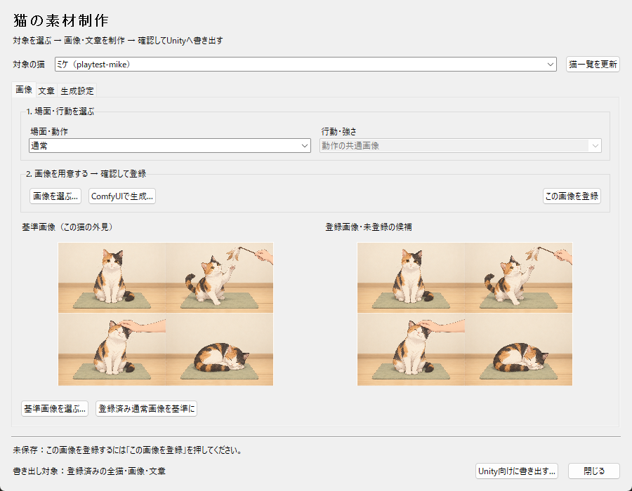
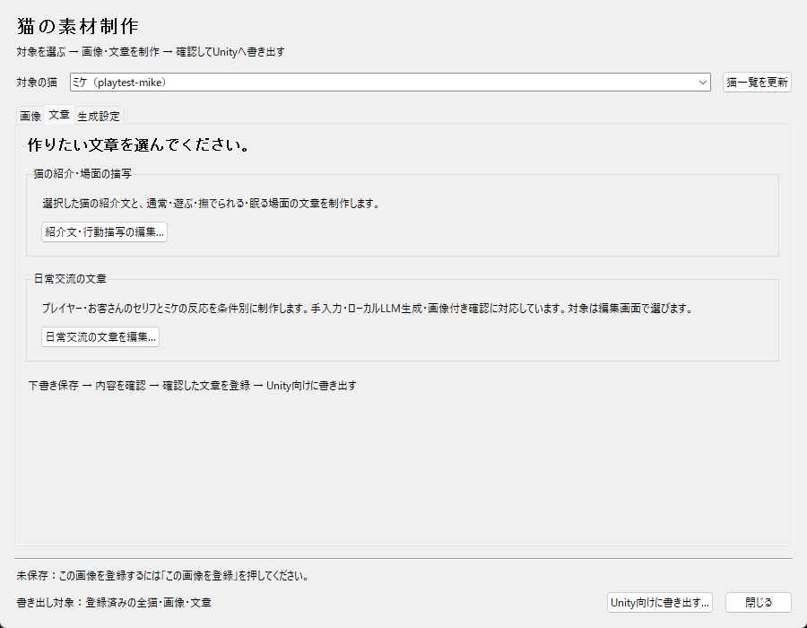

# 制作ツールのUI整理

2026-10-15。機能の追加でメイン画面の操作ボタンが縦に増え、画像を確認する領域と制作手順が分かりにくくなっていたため、作業別のタブへ整理した。

| 場所 | 操作 |
| --- | --- |
| 上部・常時表示 | 対象の猫、猫一覧の更新 |
| 画像 | 場面・行動の選択、PNG選択・ComfyUI生成・登録、基準画像と登録画像／候補の比較、基準画像の設定 |
| 文章 | 猫の紹介・場面描写の編集、日常交流文の編集・LLM生成・画像付き確認への入口 |
| 生成設定 | 現在の対象を表示し、外見・行動・背景、デザイン・ポーズLoRAの編集へ移動 |
| 下部・常時表示 | 未保存・登録などの通知、全登録素材のUnity書き出し、閉じる |

画像は「場面・行動を選ぶ」「画像を用意して登録」の順に配置し、候補の登録ボタンを右側にまとめた。基準画像の操作は比較画像の直下へ移した。文章は用途の違う2つの編集画面を説明付きで並べた。日常交流の対象は子画面で選ぶこと、書き出しは選択中の猫だけでなく全登録素材が対象であることを明示した。

画像候補・猫・場面・行動はタブ切り替えで変更しない。既存の保存・生成・登録処理、未保存交流文を閉じる際の確認は維持する。交流文の編集・書き出し結果に残っていた「Unity接続は次段階」という案内も修正した。

## 確認

- 既存テスト39件が成功（画像制作8、交流文編集17、交流プレビュー14）。GUIを有効にして実行し、画像登録、生成候補の受け取り、下書き・確認登録、未保存の保護、子画面の再利用を確認。
- 1000×760と最小900×700で全3タブを表示。見えているボタンと選択欄がウィンドウ内に収まることを座標で確認し、実画面も目視した。
- 基準画像と未登録候補を表示したまま全タブを往復し、候補を失わず、その後に登録できることを確認。検証用の猫・素材・下書きだけを一時保存先へ作成した。
- 生成サービスへの新規送信や、Unityの再ビルドは行っていない。生成処理は既存テストのモックで確認した。

検証記録は `Logs/ToolUi`（約0.50 MB）。生成画像フォルダは2,820,370,503バイトから変化なし。共有Latestは156ファイル・4,184,220,754バイトの1組で変化なし。ビルドやUnityプロジェクトの複製は作成していない。

