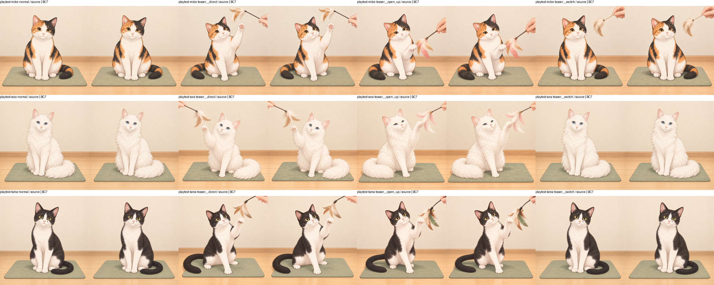

# Unity単独版の画像容量調査・設定比較

> 2026-10-24後続：今回の比較時点とは別に、[1024px・BC7最高品質の限定恒久適用と配布版検証](UnityImageImportPolicy.md)を完了。Latestは9,012,696,043 → 2,082,007,384 bytes、実測76.90%削減。以下の「未適用／0 bytes」は以前の比較・UI実装作業時点の記録。

2026-10-24。途中のユーザー回答「比較と提案までに留める」に従い、調査と比較までを実施した。**圧縮設定の適用、再ビルド、削減後Playerの検証は未実施。実際の削減量は0 bytes。** 一括適用・ビルド連携の下書きは取り除いた。ゲーム処理・本文・素材採用・Extra解放条件は変更していない。

## 容量の内訳と原因

開始・終了ともLatestは156ファイル、9,012,684,367 bytes（9.013GB / 8.394GiB）。そのうち `CatCafeStandalone_Data/resources.assets.resS` が8,921,956,544 bytes（99.0%）。UnityPlayer.dllは29,438,200 bytes、Mono本体7,900,408 bytesで、画像の改善を先に検討する根拠になる。

ResourcesのImportsは13パック、PNG 1,897枚、3,714,881,558 bytes。SHA-256で414種類、重複1,483枚。重複PNG相当は2,897,114,697 bytes。これは原本ファイルの重複量であり、そのまま配布ビルドの削減可能量ではない。

1,889枚が1254×1254、8枚が1024×1024。414種類すべてRGBで、透過画像ではない。各パックから1枚ずつ実際のインポート結果を調べたところ、1254pxはRGB24、初期の1024pxパックはDXT1だった。全画像のmetaは既定の圧縮、最大2048、Standalone overrideなし、ミップマップなし、読み書きなしだった。

1254は4の倍数でなく、Unity 2021.3のDXT/BC圧縮の寸法制約に合わない。結果として1254pxを保持する既定取り込みではRGB24になり、1枚あたり4,717,548 bytes、1,889枚で8,911,448,172 bytesになる。この値がresSの大半を説明する。**PNGの再圧縮だけでは、UnityでのこのRGB24容量は減らない。** [Unityの寸法制約の説明](https://issuetracker.unity3d.com/issues/5888/multiple-errors-appear-in-the-console-window-when-reimporting-a-scenetemplate-asset-that-contains-a-texture-with-widthheight-not-divisible-by-4)、[形式とビット数](https://docs.unity.cn/2020.3/Documentation/Manual/class-TextureImporterOverride.html)。

| パックID | PNG数 | PNG MB | 全枚RGB24とした参考MB |
| --- | ---: | ---: | ---: |
| 4762dd1bd978461bb07c041c59417281（現在） | 401 | 802.3 | 1,891.7 |
| 8d646380ed694a51be2c16dbe7b19134 | 234 | 467.1 | 1,103.9 |
| f11cad7b3f174d86a8ca4b102e9dc480 | 199 | 392.3 | 938.8 |
| 75f31c320b3f4de7978ac2c77f7eada1 | 194 | 383.5 | 915.2 |
| da80a2d0df414e9181ac6345f375cfc8 | 194 | 383.5 | 915.2 |
| ee695293218d4083b1c7a5439ec126cf | 172 | 337.5 | 811.4 |
| 7ede2b392dfb445a8b65fe85ccb88f10 | 145 | 283.0 | 684.0 |
| 9fb4383b47854aeea789ece120d4b281 | 120 | 230.9 | 566.1 |
| 23ca0b2cfd384ee38f4ff83135bb6969 | 95 | 179.7 | 448.2 |
| 734f905fa2644777a3d1059d1de1e7b0 | 70 | 131.6 | 330.2 |
| 5c611610be304b3887d1d5ad7176208a | 45 | 81.6 | 212.3 |
| 5a186caed1ce4b6cad0b62ff10d1f8a1 | 20 | 35.2 | 94.4 |
| bba09bb3938148c2b29d74af70d7e849 | 8 | 6.7 | 25.2 |

最終行は実際にはDXT1なので、参考列を実ビルド内訳として合計しない。全パックのファイル対応・設定は[容量記録](Results/ImageStorageComparison/baseline.json)、[Importer実測](Results/ImageStorageComparison/baseline-importers.csv)。MBは10進、MiBは2進。

## 比較した設定と提案

| 設定候補 | 画像データ容量／枚 | 評価 |
| --- | ---: | --- |
| 現行1254px RGB24、mipなし | 4.50MiB | 原寸保持、配布容量が大きい |
| 1024px RGBA32、mipなし | 4MiB | 縮小だけの画質比較用。RGB24なら3MiBで、圧縮ほどは減らない |
| 1024px DXT5、mipなし | 1MiB | 実測比較。同容量のBC7より模様・色の誤差が大きい |
| **1024px BC7最高品質、mipなし** | **1MiB** | 最有力の未適用案。元PNGは維持し、取り込み表現だけ変更する |
| 2048pxへ拡大してBC7 | 4MiB（理論値） | 縮小しない代案だが削減効果が小さい。未比較 |
| 512px BC7 | 0.25MiB（理論値） | 拡大画面への不足が懸念される。未比較・非推奨 |
| ミップマップ／読み書きを無効化 | 今回の追加削減なし | 既に無効。UI用途なので維持する案 |
| PNGの軽量化、パック削除 | 今回不採用 | 前者はRGB24を解消せず、後者は旧参照を壊す |

BC7は対応GPUが必要で、非対応環境ではRGBA32へ展開される場合がある。今回のGPUはDirect3D 11、RTX 5070。古いGPUや別APIでの互換・メモリは未確認。[Unity BC7説明](https://docs.unity.com/en-us/engine/6000.6/script-reference/unityengine/textureformat/bc7)。

全1,897枚をBC7 1024へ置き換えると画像データは1,989,148,672 bytes。現行RGB24と初期8枚のDXT1を差し引く概算では、Latestは約2.09GB、約6.93GB（76.9%）減になる。これはヘッダー・アライメント等を固定とした**推計であり、成功ビルドの実測ではない**。既に小さい初期8枚をDXT1のまま維持する案もあり、そのほうが約4MiB小さい。

## 代表画質比較

ミケ（三毛）、タマ（黒白）、ソラ（白長毛）の通常・ねこじゃらし準備 `teaser__switch`・実行 `teaser__direct`・特別反応 `teaser__open_up`、計12画像。原本からGPUで1024pxを作り、RGBA32／DXT5／BC7最高品質をメモリ内で比較した。原本・Importerには書き戻していない。150pxの小表示と600pxの拡大表示で計72測定。数値は原本を同じ表示寸法に描画した画像とのRGB PSNR。

| 1024px候補 | 最小dB | 平均dB | 最大dB |
| --- | ---: | ---: | ---: |
| RGBA32（縮小のみ） | 42.157 | 43.479 | 45.777 |
| DXT5 | 39.410 | 40.335 | 41.831 |
| BC7 | 41.855 | 43.071 | 45.240 |

BC7は同容量のDXT5より良好で、縮小のみとの差も小さい。目視では三毛の模様、黒白の境界、白長毛の毛先、目・耳・ひげ・玩具の輪郭を保ち、明らかなブロック状の崩れは見られなかった。原本と同一画質を保証する指標ではない。Unity Importerによる実際の縮小アルゴリズム、配布Playerの拡大画面、全猫・全場面は適用後に確認が必要。



[72測定のCSV](Results/ImageStorageComparison/comparison.csv)。全候補PNGは `Logs/ImageStorage/comparison`。原本が全RGBなので、猫画像で透過縁の圧縮を検証したとは扱わない。透過シルエットと96px人物アイコンは設定案の対象外とし、将来の透過猫画像は別に比較する。

## 参照・保存の調査と確認範囲

- `content_images.py` は採用画像をコピーし、版付きmanifestで登録する。`unity_export.py` はパックごとに新しいIDを発行し、PNGのSHA-256を画像名にする。同一パック内の画像は辞書で重複排除するが、過去パック間は共用していない。
- `ContentPreviewSetup.Import` はハッシュを検証し、Resources/Importsへ配置し、catalogだけを新パックへ切り替える。過去パックは保持する。同じIDで異なる内容を取り込まない。
- `CafeNarrativeResources` と `CafeNarratives` は確定時の `CatCafeContent/Imports/<pack>/images/<sha>` を履歴・保存へ記録する。読み直しで最新パックへ置き換えない。旧パックを削除すると、旧保存の本文を保持していても対応画像を失う。
- CGの解放キーはPNGハッシュ。Extra会話の人物画像は現在のカタログから解決する。Extra会話が必ず古いパックを直接参照しているとは扱わない。
- 重複排除をするなら、旧Resourcesパス→共用画像の永続alias表、全ロード箇所での解決、alias欠落時の旧パスへのfallback、保存文字列と解放キーを変更しない設計が必要。今回の小変更候補より影響が大きく、実装していない。

変更前Playerの既存回帰は26 checks、派遣476・設備191・支援181 checks成功。1280×800・1024×768のPlayerスクリーンショットを記録したが、支援会話中心であり、猫画像全体の画質検証とは区別する。記録は `Logs/ImageStorage/before-player`。

Editorでは通常の交流コマンドで作った現行envelopeに過去パック75f31…の画像参照を持たせ、同じCanvasを1280×800・1024×768で描画した。[1280版](Results/ImageStorageComparison/baseline-player-1280.png)、[1024版](Results/ImageStorageComparison/baseline-player-1024.png)。これは画像参照だけを分離するfixtureで、古い営業ルール全体の移行試験ではない。

この現行ルールfixtureは既存Playerの `--catcafe-narrative-resume` でも復元成功し、過去パックの保存済み画像のロードと20回の安定した読み取りを確認した。[実行結果](Results/ImageStorageComparison/baseline-legacy-result.txt)。期待本文を手組みした初回比較は失敗したが、Editorが実際に出力した本文を使った最終比較は成功した。

さらに古い `Logs/ActiveInteractionCatalog` の保存は、画像設定変更前の現行Playerで `Invalid standalone save` になった。この保存は旧rules_idが異なる。今回、営業ルール全体の旧版移行の修正へ範囲を広げていない。画像表示の互換性が全て確認済みとは扱わない。

ユーザー回答により適用を中止したため、変更後の保存復元・旧パック履歴・Extra・未登録代替表示のPlayer回帰、配布版の猫画像比較、起動・切替時間の前後比較は未実施。EditorのruntimeBytesは環境内の付加メモリも含むため、PlayerのGPU使用量へ転用しない。全目標の長期評価も繰り返していない。

## 再現と適用する場合の次の手順

読み取り専用の容量棚卸し：

```powershell
python -X utf8 cat_cafe_sim_tool/audit_image_storage.py --project C:/Users/hi-wa/unity_workspase/CatCafeSim --build Logs/StandaloneBuild/Latest --output Logs/ImageStorage/inventory.json
```

画質比較は `Editor/ContentTextureComparison.cs` を既存UnityプロジェクトのEditorへコピーし、`CATCAFE_TEXTURE_OUTPUT` に新しいログ先を指定して `CatCafePreview.Editor.ContentTextureComparison.Run` を実行する。`ContentTextureAudit.Run` は実際のImporterと現行ルールの旧画像fixture・Canvasをログ先へ出力する。どちらも圧縮設定を変更せず、Editor専用で、標準インストーラーや通常ビルドには組み込まない。今回の検証コピー2本は既存プロジェクトの `Assets/CatCafePreview/Editor` にある。

将来適用を依頼された場合は、まず大きな正方形の猫画像だけにStandalone override（max1024、BC7、quality100）、mip/read-write無効を設定し、代表Importerの実出力を比較する。小アイコン・シルエット・タイトル・非正方形素材へ一律適用しない。元PNG、GUID、パックID、catalog、保存は維持する。既存全パックへ明示適用した後、AssetPostprocessorで今後の登録画像を同じ規則へ接続する。ビルド側は読み取り専用の設定チェックを使い、不一致時は検出する案がよい。これらのコードは今回は残していない。

その後、指定の `build_standalone.ps1 -ProjectPath C:/Users/hi-wa/unity_workspase/CatCafeSim` で一回の比較ビルドを行い、Latestを置き換える。全旧パスのロード、保存内の画像文字列の往復・別プロセス復元、Extraの解放非変更、代替表示、両解像度の拡大と透過縁を確認する。実測の削減量とPlayerメモリ・切替時間を記録するまで「容量削減済み」としない。

## 容量・変更管理

ビルド0回。開始・終了のStandaloneBuild全体は9,137,988,489 bytesで同一、Latestは9,012,684,367 bytesの1組、Pendingなし。PNG全1,897枚のパス・バイト数・SHA-256と、Latest全ファイルのパス・バイト数は開始・終了で一致。ユーザーJSON4ファイルのSHA-256は変更0件。

Libraryは12,523,880,894→12,524,155,738 bytes（+274,844）。既存Libraryでの検証コードコンパイルによる小幅増加で、別キャッシュ・別Unityプロジェクトは作っていない。調査ログ `Logs/ImageStorage` は43,462,564 bytesで、主に候補比較PNG。Gitに残す代表比較・設定・Canvasはこの資料のResultsの約2.59MB。素材・制作記録・ユーザー保存は削除・上書きしていない。

自動承認レビューは共有ビルドへの一括設定適用を「比較を超える恒久変更」として拒否した。明示確認後のユーザー回答により比較・提案までへ範囲を変更した。最終状態に設定変更・自動適用・ビルドガードは含まれない。`Docs/DevelopmentStatus.md` はこのGitリポジトリの外にあるため、別途更新し、このコミットには含められない。

## 2026-10-24：新UIの実寸で再評価

[新UIの画質再評価・比較資料](UnityImageStorageNewUI.md)で400／320pxの代表12画像を比較し、ミケ実行を既存Canvasでも一時差替えした。1024px BC7最高品質を限定適用の推奨候補とするが、実Importer・削減後Playerは未確認。設定未適用、削減量0 bytes、約6.93GBは引き続き推計。比較画像・数値・互換性・適用時の検証は同資料を参照。
