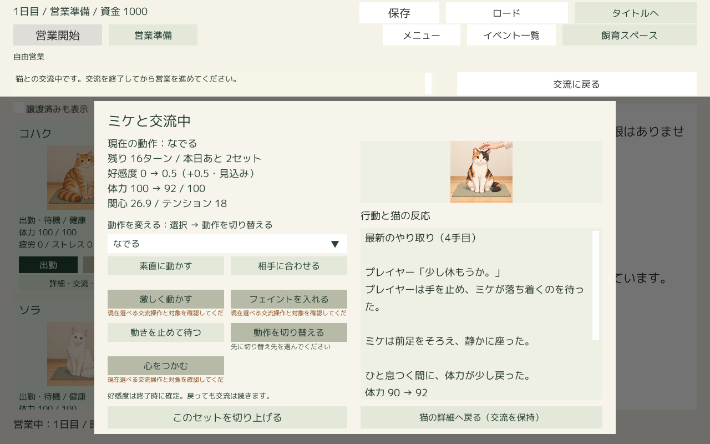
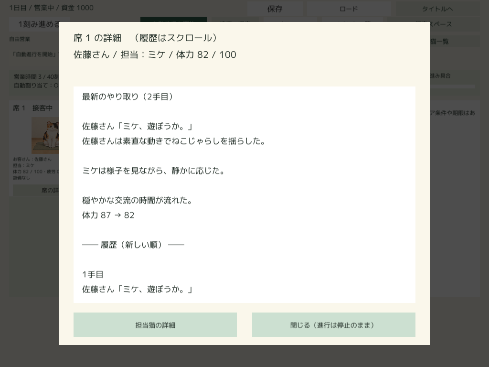

# ミケの日常交流の文章表示試作

2026-10-14実装。`Docs/FutureDevelopmentPlan.md` の「日常の接客・個別交流の文章表示」を基に、Unity単独版の既存画面へ接続した。

## 表示と記録

- 席一覧の「席の詳細」から、現在の来客・担当猫と最新の文章、同じ接客内の過去文章を読む。空席は空席案内を表示する。「担当猫の詳細」への入口も残す。
- 個別に遊ぶ画面の履歴を、最新のやり取り→過去の文章（新しい順）→既存の数値履歴へ拡張した。新しい行動の後は先頭へ戻し、同じ状態の再表示では閲覧位置を維持する。
- ねこじゃらし、なでる、休憩を事前制作した文章で描く。人のセリフ・行動文、ミケの仕草、地の文、実際の体力の前後を表示する。行動の強さ・切り替え・特別反応・体力切れにも短文を用意した。それ以外の交流種別は実際の動作名を使う短い共通文で補う。
- `favorable`／`enthusiastic` は穂先に前足を伸ばす・手に頬を寄せる、`turn_away` は顔を背ける、`confused` は迷う、`listless` は動かず休みを必要とする描写に対応する。休憩は実際に体力が増えた場合だけ回復したと書く。好みだけで結果を推測しない。

`CafeNarratives` が確定した接客行動とプレイヤー行動を観測し、その時点で文章を制作する。文章のための抽選はない。履歴の再表示では保存済みの文字列を読む。`PlayerHistory` の既存の数値履歴再構成は独立した一時オブジェクトで行い、文章を追加したり本体を進めたりしない。

接客のキーは「日・来客ID・担当猫ID・着席刻」、プレイヤーのキーは既存の交流セットID。実際の行動番号を保存し、旧セーブの途中から文章記録を始めても1手目に戻らない。客の入れ替わり・翌日・別セットで前の文章を混ぜない。ミケ以外には文章記録を作らない。

## 保存と進行

文章の版、交流キー、日、席、行動番号、人／猫ID、動作・行動・実際の反応、確定した本文を保存封筒の任意項目 `narratives` に保持する。数値ルール・ゲーム状態・旧リプレイのダイジェストには加えない。ロード前に件数・版・日・猫・本文・キーの重複を検証する。文章のない旧セーブも読めるが、観測していない過去文章は作らない。記録済み本文は今後テンプレートを変更しても再制作しない。

席の詳細を開くと通常の自動進行を停止する。閉じても自動再開せず、既存の「自動進行を開始」から明示的に再開する。複数日おまかせ実行中は既存の操作制限に従い詳細を開けない。文章を読む・スクロールする・閉じる・猫詳細へ戻るだけではターン、体力、親しみ、売上、乱数を変更しない。

## 検証結果

| 検証 | 結果 |
| --- | --- |
| .NET専用67 assertions | 実行済みのねこじゃらし・なでる・休憩、30回の同一閲覧、途中保存再開、セット分離、同じ席への複数来客、完了接客の保存再開、空席、文章のない旧保存から5手目で記録再開、反応別の描写を確認 |
| .NET別プロセス2 assertions | ディスクから再開した文章が同一で、閲覧前後のゲーム状態が同一 |
| 既存回帰 | 20ターン123 assertions、最大体力成長193 assertionsが成功 |
| Unity 2021.3.45f1 | 通常の保存・ロード窓口、JsonUtility、実状態表示で文章の一致と閲覧による状態不変を確認。Windows Playerビルド成功 |
| 配布Playerの別プロセス | Editorで保存した交流途中をロードし、本文一致、20回の安定した閲覧、ゲーム状態不変を確認。`player-resume.txt` に成功を記録 |
| 実画面の描画・目視 | 実際の既存UnityシーンのCanvasを描画。個別交流は1280×800で最新と履歴末尾、席は1024×768・1280×800・1920×1080、空席は1280×800で確認。文字の重なり・枠外のボタンなし。長文はスクロールで読める |

**拒否の検証範囲：** 標準のミケは全行動の好み・全強度が正の値なので、今回のねこじゃらし・なでるでは通常の `turn_away` に到達しない。拒否はミケのプロフィールを複製し、ねこじゃらしの好みを0にした判定境界のfixtureで、実際の `StepExchange` の結果と描写を検証した。製品のミケの好みや反応ルールは変更していない。好反応・低体力は標準プロフィールと実処理で検証した。

画面検証はCanvasの実描画と目視であり、マウスによる長時間の手動プレイを実施した意味ではない。Playerの別プロセス検証は表示用保存の再開に限定し、画面操作の総合プレイテストではない。

当初の個別交流の文章枠は高さ208で、休憩の最新文章でも途中までしか見えなかった。ミケの文章表示時は画像を112高へ縮め、本文枠を310高・18ポイント・行間1.15へ拡張した。休憩の最新のセリフ・行動・反応・地の文・体力が一画面に収まり、過去の長文も下までスクロールできる。





## 再現

作業ルートから実行する。

```powershell
dotnet build cat_cafe_sim_tool/tests/standalone/StandaloneChecks.csproj -p:UseAppHost=false
dotnet cat_cafe_sim_tool/tests/standalone/bin/Debug/net8.0/StandaloneChecks.dll --narratives cat_cafe_sim_tool/unity_preview_template/Resources/CatCafeStandalone/rules.json Logs/StandaloneNarratives/final-checks
dotnet cat_cafe_sim_tool/tests/standalone/bin/Debug/net8.0/StandaloneChecks.dll --narrative-resume cat_cafe_sim_tool/unity_preview_template/Resources/CatCafeStandalone/rules.json Logs/StandaloneNarratives/final-checks
```

Unity入口は `CatCafePreview.Editor.NarrativeVerification.VerifyAndBuild`。`CATCAFE_NARRATIVE_OUTPUT` に検証先、`CATCAFE_STANDALONE_BUILD` にexeの絶対パスを設定する。最終検証先は `Logs/StandaloneNarratives/verified`、ビルドは `Logs/StandaloneBuild/Latest/CatCafeStandalone.exe` に固定し、`build_standalone.ps1 -ExecuteMethod CatCafePreview.Editor.NarrativeVerification.VerifyAndBuild` から実行する（[保存ルール](BuildStorage.md)）。配布Playerへ `-batchmode -nographics --catcafe-narrative-resume <検証先の絶対パス>` を渡すと別プロセスの保存再開を検証する。ログと保存はGit管理外、本文と代表画面2枚は本資料と共にGit管理する。

今後は他の猫の専用文章、客ごとの口調、終了した接客や過去セットを一覧から選ぶ回想、全交流種別の専用文、行動描写の校正を拡張できる。今回の閲覧対象は現在の接客と既存UIが示す最新の個別交流セットであり、Extraへの登録は行わない。


## 2026-10-17追補：営業中の席カード

[直近の行動・猫画像・反応の席カード表示](UnitySeatActionCards.md)を実装した。席詳細と同じ確定receiptを使用し、全8行動・登録済み8匹・画像未登録猫の代替表示に対応。切り替えの準備画像と特別発動の画像参照も新しいreceiptへ保存する。過去の記録は書き換えず、ルール・バランスを維持した。検証・実画面・容量・残る課題はリンク先を参照。
