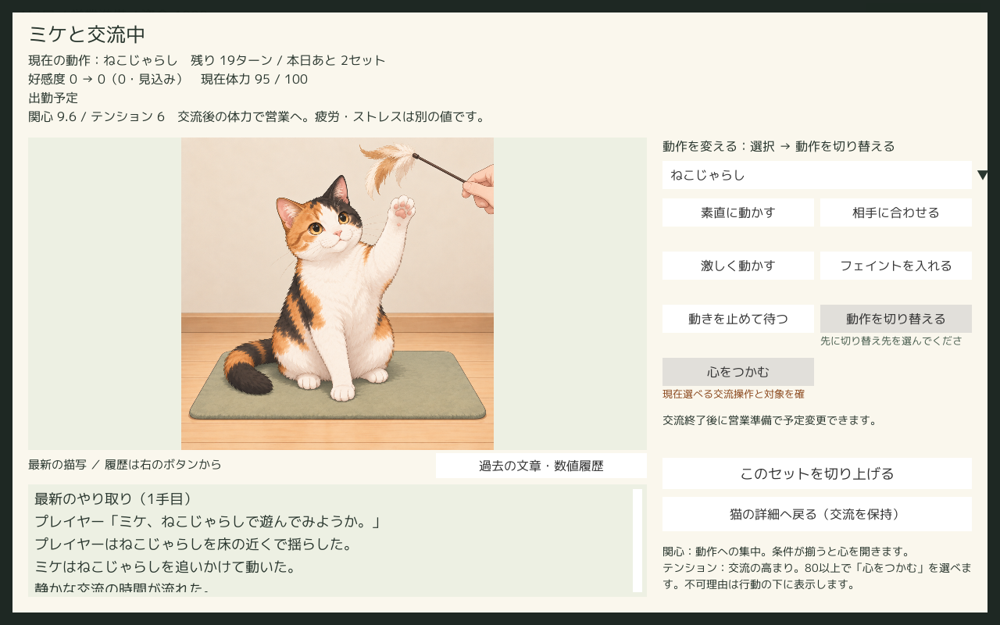
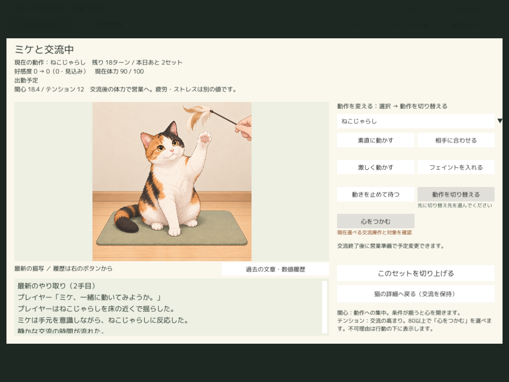

# 個別交流の大画像レイアウト（2026-10-24）

> 2026-10-24後続：今回の比較時点とは別に、[1024px・BC7最高品質の限定恒久適用と配布版検証](UnityImageImportPolicy.md)を完了。Latestは9,012,696,043 → 2,082,007,384 bytes、実測76.90%削減。以下の「未適用／0 bytes」は以前の比較・UI実装作業時点の記録。

設計の正本は[共有計画](../../Docs/UnityPlayerImageLayoutPlan.md)。本書は実装・検証記録。

## 最終仕様

交流専用カード1248×768をCanvas中央へ配置。Canvasは1280×800基準、ScaleWithScreenSize / Expand。1024×768では0.8倍となり、カード998.4×614.4pxを画面中央に収める。営業画面を覆うが営業・おまかせを開始しない。

- 上部：動作・残り20ターン制の残数・残りセット、好感度見込み／確定、最新の現在／最大体力、出勤／休養、関心・テンション。
- 左：画像枠792×400（Canvas座標）を固定。FitInParentを維持し、文章量・履歴・結果で縮めない。全身・道具・手を元画像の比率で表示。
- 右：動作選択、行動・強さ、各選択不可理由、手動終了、詳細への復帰。関心／テンションの説明と既存ルールのoptional_thresholdから「心をつかむ」の条件値（現行80）を表示する。
- 左下：幅792・高さ144の独立スクロール。通常は最新描写、空行だけを詰めて本文を保持。「過去の文章・数値履歴」で全履歴に切り替える。旧数値のみの応答は最新ブロックを通常表示し、全記録は履歴で読む。
- 結果：右側に確定理由・体力／休養回復の説明、営業準備への直接復帰。猫詳細から前回の交流を再表示できる。

| 正方形の表示 | 変更前・文章あり | 変更後 | 画像の画面占有率 |
| --- | --- | --- | --- |
| 1280×800 | 112×112px（枠436×112） | 400×400px（枠792×400） | 1.23% → 15.63% |
| 1024×768 | 89.6×89.6px | 320×320px | 1.02% → 13.02% |

画像の辺3.57倍・面積12.76倍。枠の占有率は1280で4.77%→30.94%、1024で3.97%→25.78%。実測は[dimensions.txt](Results/PlayerImageLayout/dimensions.txt)。前の正方形寸法は旧コードと同一Canvasの[変更前1280](Results/ImageStorageComparison/baseline-player-1280.png)／[変更前1024](Results/ImageStorageComparison/baseline-player-1024.png)による。




長文はスクロールが必要。画像を縮めて全文を常時収める方式にはしていない。ミケとコハクの大表示で顔・模様・毛先・手・玩具輪郭を目視し、元素材の明確な破綻は見られなかった。全猫・全素材の品質を保証する確認ではない。縦横比違いは寸法fixtureで確認し、代表の実猫素材は正方形。

## 再生成・互換

`PlayerInteractionLayout.Apply` をランタイムと `PythonPlayerLayout.Build` で共有。基本 `PythonPlayerSetup.Build` も配置生成へ接続。インストーラーに新規Runtimeと検証ファイルを追加した。実Unityには対象コードだけ同期し、既存シーンを再生成した。素材・PNG・GUID・パック・圧縮・保存スキーマ・20ターン・数値計算は変更していない。

最新／履歴の分離は既存の表示見出しから行う。サーバーの見出し表現を変更する場合はこの表示処理も追従が必要。既存の画像選択経路（保存画像→準備／実行／特別反応→代替）を維持。別ゲーム・別セッションでは履歴閲覧状態をリセットする。新しい画像・パック・検証用Unityプロジェクトは作っていない。

## 検証の区別

| 区分 | 確認した範囲 | 結果 |
| --- | --- | --- |
| .NET既存回帰 | 20ターン完走・体力切れ・pause・手動終了・旧10ターン・旧新混在・おまかせ | 123 assertions成功 |
| .NET案内 | 体力しきい値・休養・最大値・保存 | 37 assertions成功 |
| Editor生成／境界 | 基本生成→配置生成、画像優先・特別反応・代替、不可理由、切替送信、連打抑止、詳細往復、終了・未接続・別ゲーム | 既存BuildAndVerify成功 |
| Editor比率fixture | 比率0.6／1／1.8／3、比率維持・枠内 | 成功。実画像追加なし |
| 最終配布UI自動 | ミケ・両解像度・通常行動、履歴開閉の状態不変、長文80行、最大250/300、代替画像、途中・終了保存、詳細／準備復帰 | 36 checks成功 |
| 別プロセス | 終了slot2／途中slot3から再開、交流記録の存在 | 各2 checks成功 |
| 最終配布体力回帰 | 猫切替・自動体力切れ・結果→詳細／準備→対象のみ休養・変更不可理由・別ゲーム | 71 checks成功。batchmodeの黒画像は目視根拠にしない |
| 過去パック画像 | 現行ルールの過去画像参照fixtureを専用コピーで復元、画像ロード、20回の安定読み取りと状態不変 | 成功 |
| Windows実入力 | コハク・1024×768。履歴、行動、選択のみ／切替、手動終了、詳細と結果往復、営業準備、対象のみ休養 | 成功。[実入力記録](Results/PlayerImageLayout/physical-input.md) |

配布UI自動は通常のボタンリスナーを呼ぶ検証。境界fixture・物理マウスを区別する。最終PNGは `Logs/PlayerImageLayout/verified`、前のコハク画面は `final`、実入力専用保存は `physical`。これらはユーザー保存先ではない。

最初の専用検証のFinish失敗は、直接save_gameした後に古いrevisionのUIから送信したテスト側の誤り。保存後のApplyを追加し成功。最初の隠した起動とbatchmodeでは黒いPNGが出たため表示確認から除外し、解像度変更後の描画あり画像を取り直した。通常起動時の製品不具合として数えない。

旧10ターンの数値／再現と現行ルールの古い画像参照は確認したが、rules_idの異なる旧営業ルール全体の移行は追加検証していない（従来の制限を維持）。特別反応の選択はEditor fixture、全特別反応の物理入力通しではない。最大300は境界fixtureで、自然育成ではない。全目標長期評価・総合一式・Python旧形式56ケースは繰り返していない。

## 再現・容量・変更管理

```powershell
./cat_cafe_sim_tool/build_standalone.ps1 -ProjectPath C:/Users/hi-wa/unity_workspase/CatCafeSim -ExecuteMethod CatCafePreview.Editor.PlayerImageLayoutVerification.Build
# 固定Latestのexeへ --catcafe-player-layout <専用ログ先>
# 同じ保存先で --layout-resume（終了slot2）、さらに --layout-active-resume（途中slot3）
# 実入力用に停止して待つ場合は --layout-hold
```

最終ビルドログ：`Logs/StandaloneBuild/Runs/20261024-155754-412-7e66229707d640ab8d40849cdc188f8f.log`。基本生成と比率fixtureの成功マーカー `CAT_CAFE_PLAYER_IMAGE_REGEN_VERIFIED` を確認。初回のみライセンス接続でexit199、その後は通常のホスト側実行で成功。

開始時StandaloneBuild 9,137,988,489→終了9,142,002,840 bytes（+4,014,351、主にRunsの実行ログ）。Latestは9,012,696,043 bytes・156ファイルの1組、Pendingなし、子フォルダーはLatest／Runsのみ。検証途中はPendingを使い、成功時に移動して置換。ZIP・別の成功ビルドは作っていない。

終了Logs全体19,210,493,431 bytes。今回の `Logs/PlayerImageLayout` は13,080,866 bytes（主に検証PNGと専用保存）。既存Library終了12,524,130,696 bytes。ビルド途中の容量記録は走査中にPendingが置換される非原子的参考値であり、開始／終了比較へ使わない。開始時はStandaloneBuildを含む各Logs子フォルダー容量を実行出力で記録したが、Libraryの厳密な開始値は採取できていない。[終了容量](Results/PlayerImageLayout/capacity-end.json)。他作業の成果物・素材・ユーザー保存を削除していない。

制作ツールの既存ハル画像・文章・素材変更は今回のコミットへ含めない。実Unityは先行差分が多数あるため、同期コードと再生成シーンを未コミットで保持する。共有DocsはGit外で、README／DevelopmentStatus／UnityPlayerImageLayoutPlan／UnityPlayerPresentation／UnityUIFixRequestsを更新。

残る確認は全猫・全反応の大表示品質、代表解像度以外・長い名前の網羅、異なる旧rules_idの移行。画像容量削減は比較・提案段階のままで、今回へ混ぜていない。

## 2026-10-24：圧縮候補の大表示比較

[新UIの画質再評価](UnityImageStorageNewUI.md)で、三毛・白黒・白長毛の通常／準備／実行／特別反応を400／320pxで比較。ミケ実行は既存新UI Canvasで現行RGB24と一時BC7を撮影した。画質上は1024px BC7最高品質を推奨候補とする。実Importer・配布Playerでの圧縮後確認は未実施で、設定適用・ビルド・UI変更は行っていない。
