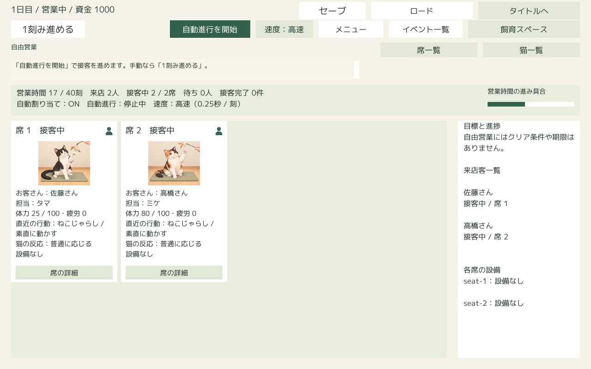

# 営業中の席カード：直近の行動と猫の反応

2026-10-17実装。`Docs/FutureDevelopmentPlan.md` の「営業中の席カード」、[文章記録](UnityMikeNarratives.md)、[全8匹の画像方針](CatExecutionImages.md)を確認して接続した。

## 実装

- `LocalCafeBackend.View()` が `CafeNarratives.LatestSeat()` の同じreceiptから、画像参照・行動名・短い反応を渡す。詳細本文も同じ接客キー（日・客・猫・着席刻）から読む。画面描画で `StepExchange`、履歴リプレイ、文章選択は実行しない。
- ミケの頭なで・ねこじゃらしを入口に、全8モードと全猫の確定行動を記録する。専用文章や画像が未登録の猫も、実際の猫名を使う既存共通文と行動名を記録する。新たな専用素材や文章候補は作らない。
- 切り替えのreceiptへ既存の準備画像を保存する。通常／穏やかな実行は登録済み実行画像、拒否・戸惑い・低体力は既存 `UsePreparationImage` の方針を維持する。強い行動・フェイントなどの素材フォールバックも既存登録に従う。
- 発生時の確定結果から任意フィールド `special_reaction` に心をつかむ／心を開く／同時発動を記録する。心を開く／同時発動の画像は、その時点のbundleから既存の専用画像を解決し、パックIDを含む画像参照をreceiptへ保存する。後からゲージや累積回数を読んで過去の発動を推測しない。
- 画像がない・Resourcesで読めない場合は、その猫の既存基準画像（未登録猫は既存シルエット）を表示し、行動名・反応は維持する。拒否で実行画像を補完することはない。
- 空席は画像なし、配置待ちは案内、担当ありでreceiptなしは「行動の記録なし」。ゲームでは未配置の客は席を占有せず待ち列にいるため、空席に「担当待ちのお客さんがいます」と案内し、上部の待ち人数・手動配置導線も維持する。
- 表示保持キャッシュは設けず、毎回画像・行動名・反応をまとめて最新receiptから更新する。退店・別の客／猫・日・新規開始・別セーブへの切り替えで古い表示を引き継がない。旧保存のreceiptと本文は書き換えない。記録のない過去や保存されていない特別反応は復元しない。
- 席専用カードを230×350、文字欄を210×164・15ポイントへ拡張。猫一覧のカードは変更しない。席数が多い場合は既存スクロールを使用する。

## 検証

- .NETの既存文章67 assertions、別プロセス保存再開2 assertions成功。再表示でゲーム状態が不変、文章の保存再開、客／セット分離、旧保存からの記録開始を含む。
- Unity `SeatActionVerification.VerifyAndBuild`：3,318 assertions成功。8匹×8モードの実 `StepExchange`→観測receipt→backend→UGUIを確認。切り替え・通常・穏やか・拒否・戸惑い・低体力・心をつかむ・心を開く・同時発動、カードと席詳細の本文／画像一致、体力などの状態不変、ディスク保存再開、担当猫変更、記録なし旧保存、別セーブ、担当待ち、未登録画像を検証した。
- 反応境界はfixtureの好み・体力・ゲージを調整し、製品のルールを変えず実処理で発生させた。加入猫は検証用の初期猫に追加し、依頼候補IDを分離している。
- 標準ルールの営業を25刻まで進め、2席同時接客と後続来客を確認。通常／高速表示、1024×768・1280×800・1920×1080を実Canvasで描画し、全反応の文字欄の必要高さも検査。ミケの準備・実行・拒否・特別反応と複数席画面を目視し、文字切れ・席間の画像取り違えなし。
- 配布Playerの既存UIスモーク拡張：222項目成功、errors 0、exit 0。実際の通常1秒／高速0.25秒の自動進行を各3刻以上動かし、2席の表示をreceiptと照合。1日の最終状態は独立シミュレーションのゲームダイジェストと一致した。営業、退店、閉店、次の日、ロード、別状態への切り替え、おまかせの保存制御も既存チェックが成功。結果は `Logs/SeatActions/Player/result.json`。

検証入口は `unity_preview_template/Editor/SeatActionVerification.cs`。`CATCAFE_SEAT_OUTPUT` に絶対パスを設定し、次を実行する。

```powershell
$env:CATCAFE_SEAT_OUTPUT='C:/Users/hi-wa/source/codex_repos/CatCafeSim/Logs/SeatActions'
./cat_cafe_sim_tool/build_standalone.ps1 -ProjectPath C:/Users/hi-wa/unity_workspase/CatCafeSim -ExecuteMethod CatCafePreview.Editor.SeatActionVerification.VerifyAndBuild
```

実Playerは固定のexeへ `--catcafe-ui-check <絶対パス>` を指定する。通常1秒／高速0.25秒の実タイマー、UGUIボタンのクリックイベント、画面描画、保存・再開を使う既存スモークへ席の記録一致検証を追加した。人がマウスを使う長時間プレイを実施した意味ではない。




## 表示上の判断・残る課題

高速でも最新記録を優先するため、0.25秒で変わる文章を全文読む用途には向かない。カードの短い反応で状況を把握し、詳細を開いて進行を止め、保存済み履歴を読む。特別反応の時間保持は今回導入しない。将来の保持演出を追加する場合も画像・行動・反応を同じreceiptに固定し、客／猫／セーブの切り替えで解除する必要がある。

旧保存に特別反応の明示記録や画像参照がない場合は基準画像に戻る。専用画像のない猫は代替表示となる。Python HTTP版のサーバー応答へ新しいカード用ラベルを追加する変更は対象外で、今回の営業表示はUnity単独版で検証した。

## ビルド・容量・コミット範囲

指定の `build_standalone.ps1` と共有 `StandaloneBuildStorage.Build` を使用し、成功ビルドは `Logs/StandaloneBuild/Latest/CatCafeStandalone.exe` の1組だけとする。ZIP・別ビルドフォルダ・Unityプロジェクト複製・検証用Libraryは作成していない。ログは `Logs/StandaloneBuild/Runs`、検証画面／保存は `Logs/SeatActions`。

開始時は `Logs/StandaloneBuild` 8,252,766,113 bytes、既存Unity `Library` 10,982,536,096 bytes。終了時はStandaloneBuild 8,254,397,740 bytes（＋1,631,627 bytes、約1.56 MiB）、Latest 8,247,456,140 bytes、Runs 6,941,600 bytes、今回の検証記録 8,570,365 bytes、Library 10,982,535,494 bytes（−602 bytes）。大きな増加はなく、追加容量は実行ログ・検証画像と管理コードが中心。Latestの1組のみ、Pending／Previousなし。詳細は [Verification.json](Results/SeatActionCards/Verification.json)。素材・ユーザーセーブ・既存の別作業パックは削除していない。

変更はランタイム・専用検証入口・既存UIスモークの追加チェック・本資料に限定する。既存未コミットの猫資料、rules、presentation、画像パック／catalog、別リポジトリの変更をコミットに含めない。ルール・係数・行動選択・乱数・報酬処理は変更しない。


2026-10-27追補：5席以降の下段に到達しにくい既存スクロールを改善し、基本生成・配置再生成も350高へ統一した。[席一覧のスクロール修正・両解像度の実クリック・容量](UnitySeatListScroll.md)を参照。行動・反応・画像の選択処理は維持。
